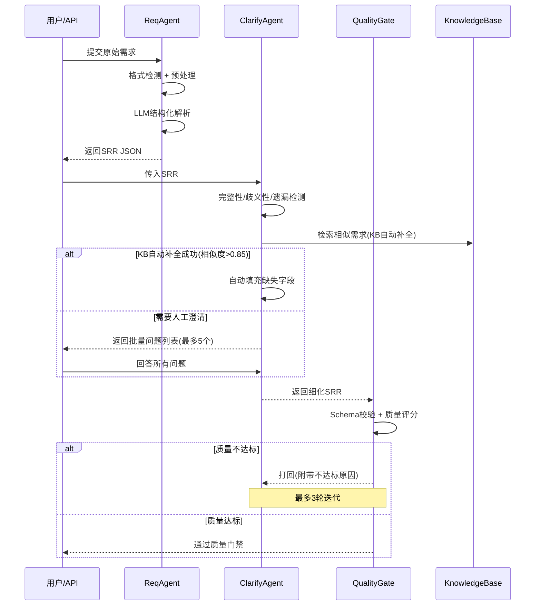

# 00 — 系统架构总览

> AI 驱动需求解析 → 需求澄清 → 测试用例自动生成 系统完整架构设计  
> 版本: v2.1 | 日期: 2026-07-21

---

## 1. 系统定位

构建一套 **"需求驱动 + AI 自动生成测试用例"** 平台。核心理念：

> 将非结构化/半结构化的软件需求文档，通过 LLM 解析为结构化表示，经需求澄清闭环确保需求质量，结合历史知识库的上下文检索，自动生成高质量、可执行、可追溯、可回流的测试用例。

**目标场景**：中大型软件项目中的功能测试、回归测试、API 测试用例自动生成，减少手工编写工作量 60%+。

---

## 2. 五层架构全景

```
┌─────────────────────────────────────────────────────────────────────┐
│                     接入层 (Access Layer)                           │
│  ┌──────────┐  ┌──────────┐  ┌──────────┐                         │
│  │ Web UI   │  │ API GW   │  │ CLI Tool │                         │
│  └──────────┘  └──────────┘  └──────────┘                         │
│                                                                     │
│  🔒 L1 防护: RPM+TPM 双轴限速 (Token Bucket+Redis) | 输入校验      │
└──────────────────────────┬──────────────────────────────────────────┘
                           │
┌──────────────────────────▼──────────────────────────────────────────┐
│                   编排层 (Orchestration Layer)                      │
│                                                                     │
│  ┌─────────────── Agent Pipeline (LangGraph DAG) ────────────────┐ │
│  │                                                                │ │
│  │  ReqAgent ──► ClarifyAgent ──► QualityGate ──► ImpactAnalysis  │ │
│  │  (需求解析)   (需求澄清)      (质量门禁)      (影响分析)⭐ 核心    │ │
│  │            │              │             ▲            │ │
│  │            └──────────────┴─────────────┘            │ │
│  │           不达标则打回 ClarifyAgent                     │ │
│  │                                                          │ │
│  │  ⭐ v2.0 架构演进：双 SRR 分层（交互层 + FP 内部层）       │ │
│  │    · 总 SRR（interaction_srr）：跨 FP 交互规则/共享约束/契约│ │
│  │    · FP 子 SRR（sub_srr）：FP 专属内部流程/规则/约束       │ │
│  │    · 一条规则只在一处定义，消除重复                          │ │
│  │                                                          │ │
│  │  ⭐ ImpactAnalysis 核心价值：                              │ │
│  │    初期（新需求为主）：简单版本链检查，轻量运行            │ │
│  │    后期（优化需求为主）：                                        │ │
│  │    · 自动识别被优化需求（"优化登录流程"）                  │ │
│  │    · 从版本链找到原始需求 + 历史用例                        │ │
│  │    · 依赖图谱遍历，找到所有受影响的上游/下游需求            │ │
│  │    · 生成影响范围报告 + 回归测试推荐                        │ │
│  │    · 指导 GenAgent 只生成/更新受影响的用例（非全量）      │ │
│  │    参考：微软 20 万测试套件，智能选取 12-15% → 94% 召回率  │ │
│  │                                                          │ │
│  │                               ▼                       │ │
│  │                            GenAgent ──► ReviewAgent      │ │
│  │                            (用例生成)    (质量审核)       │ │
│  │  ⚠️ MatchAgent（知识匹配）v3.1 起已移除                   │ │
│  │    原由：生成阶段不再从知识库检索历史用例（SRR 已足够详细）│ │
│  │    替代：Few-shot 示例注入 Prompt + FP 定向生成上下文      │ │
│  └────────────────────────────────────────────────────────────────┘ │
│                                                                     │
│  🔒 L2 防护: 断路器(三状态机) | 指数退避+全抖动重试 | 多提供商故障转移│
└──────────────────────────┬──────────────────────────────────────────┘
                           │
┌──────────────────────────▼──────────────────────────────────────────┐
│                    引擎层 (Engine Layer)                            │
│  ┌────────┐ ┌────────┐ ┌────────┐ ┌────────┐ ┌────────┐           │
│  │ Prompt │ │Embedding│ │  RAG  │ │Format  │ │Quality │           │
│  │Engine  │ │Engine  │ │Engine │ │Engine  │ │Monitor │           │
│  └────────┘ └────────┘ └────────┘ └────────┘ └────────┘           │
│                                                                     │
│  🔒 L3 防护: 输出Schema校验 | LLM-as-Judge(5%采样) | Embedding漂移  │
└──────────────────────────┬──────────────────────────────────────────┘
                           │
┌──────────────────────────▼──────────────────────────────────────────┐
│                    数据层 (Data Layer)                              │
│  ┌────────────┐  ┌─────────────┐  ┌────────────┐                   │
│  │ Vector DB  │  │ PostgreSQL  │  │ Object Store│                   │
│  │  Milvus    │  │ + pgvector  │  │ MinIO/S3   │                   │
│  │Milvus     │  │             │  │             │                   │
│  │            │  │ Collections:│  │             │                   │
│  │- 需求嵌入  │  │ - reqs      │  │- 原始需求   │                   │
│  │- 用例嵌入  │  │ - cases     │  │- 测试报告   │                   │
│  │- 模式嵌入  │  │ - patterns  │  │- 日志归档   │                   │
│  │- 错误案例  │  │ - errors    │  │             │                   │
│  │            │  │ - trace     │  │             │                   │
│  └────────────┘  └─────────────┘  └────────────┘                   │
│                                                                     │
│  🔒 L4 防护: 死信队列(DLQ) | 死锁预防(幂等守卫) | KB 静默跳过(人工澄清兜底) │
└─────────────────────────────────────────────────────────────────────┘
```

### 稳定性保障横切说明

稳定性保障不是独立模块，而是**贯穿所有层级的横切关注点**：

| 层级 | 防护措施 | 核心组件 | 实现位置 |
|------|---------|---------|---------|
| L1 接入层 | 双轴限速、输入校验 | TokenBucket (Redis Lua) | API Gateway 中间件 |
| L2 编排层 | 断路器、重试、故障转移 | CircuitBreaker + RetryFramework + LiteLLM | Agent 调用包装层 |
| L3 引擎层 | 输出校验、质量监控 | QualityMonitor (Schema + LLM-Judge) | Engine 输出后处理 |
| L4 数据层 | 死信队列、死锁预防 | DLQ (Redis List) + IdempotencyGuard | 数据写入层 |

---

## 3. 核心数据流

```
原始需求输入
     │
     ▼
┌──────────────────────────────────────────────┐
│ ① ReqAgent 需求解析                          │
│    原始文本 → SRR JSON (三级递进模型)        │
│    格式检测 → 预处理 → LLM结构化 → 字段校验  │
│  ⭐ v1.5.1: 解析后自动提取功能点(FP)+依赖关系 │
│  ⭐ v2.0: FP 提取同时产出 interaction_srr    │
│           （总 SRR = 交互层，不重复 FP 内部规则）│
└──────────────────┬───────────────────────────┘
                   ▼
┌──────────────────────────────────────────────┐
│ ② ClarifyAgent 需求澄清                      │
│    完整性检测 (Checklist规则)                │
│    歧义性检测 (规则+LLM语义分析)             │
│    遗漏检测 (需求模式库对比)                 │
│         │                                    │
│    KB自动补全 (相似度>0.85 → 自动填充)       │
│    ⭐ v2.0: 基线补全精准化 — 按问题维度返回  │
│           精准答案（_detect_baseline_focus）   │
│    KB无法解决 → 生成问题列表 → 人工回答      │
│    需求细化 → SRR v2                         │
│    (最多3轮迭代，质量达标才放行)              │
└──────────────────┬───────────────────────────┘
                   ▼
┌──────────────────────────────────────────────┐
│ ③ QualityGate 质量门禁                       │
│    Schema校验 → 关键字段 → 质量评分          │
│    不达标 → 打回 ClarifyAgent                │
│    ✅ 通过 → 进入生成流程                    │
└──────────────────┬───────────────────────────┘
                   ▼
┌──────────────────────────────────────────────┐
│ ④ ImpactAnalysisAgent 影响分析 ⭐ 核心      │
│    （初期新需求为主：轻量执行，仅版本链检查）    │
│    （后期优化需求为主：完整执行，核心价值）      │
│                                                  │
│    优化需求场景：                                  │
│    1. 读取上游已补全的 optimization_context      │
│    2. 版本链遍历 → 获取优化前完整上下文        │
│    3. 依赖图谱遍历 → 找到所有受影响需求        │
│    4. 生成影响范围报告 + 回归测试推荐        │
│    5. 注入 GenAgent Prompt → 指导生成范围     │
│                                                  │
│    新需求场景：                                    │
│    → 跳过（srr.optimization_context 为空，仅做轻量版本链检查）│
└──────────────────┬───────────────────────────┘
                   ▼
┌──────────────────────────────────────────────┐
│ ⑤ GenAgent 用例生成                          │
│    ⚠️ v3.1: 不再从知识库检索历史用例          │
│    多维并行: 功能|边界|异常|安全|性能         │
│    + FP 定向生成 (每个 FP ≥ 1 用例)          │
│    + Few-shot 示例注入 Prompt ⭐ v2.0.1      │
│       (2 份完整 UTCF 用例模板：功能+异常)     │
│    + 可追溯性标注                              │
│    + 影响范围指导 (仅更新/新增受影响的用例)    │
│    → 候选用例集                              │
└──────────────────┬───────────────────────────┘
                   ▼
┌──────────────────────────────────────────────┐
│ ⑥ ReviewAgent 质量审核                       │
│    六维审核: 完整性|去重|可执行|一致性|优先级 │
│    + 追溯性验证 (每个用例必须有需求依据)      │
│    + related_fp → Traceability 追溯 FP 关系  │
│    → 高置信度自动入库 / 低置信度人工审核     │
└──────────────────┬───────────────────────────┘
                   ▼
┌──────────────────────────────────────────────┐
│ ⑦ FormatEngine 格式输出                      │
│    UTCF JSON + Gherkin/pytest/JUnit 转换     │
│    ⭐ XMind 8 (XML) + XMind 2020+ (JSON)     │
│       双格式导出（用例+需求均支持）           │
│    + 覆盖率矩阵 (需求→用例覆盖映射)          │
└──────────────────┬───────────────────────────┘
                   ▼
┌──────────────────────────────────────────────┐
│ ⑧ 回流存储                                   │
│    向量DB + PG 双写                          │
│    + 需求模式库更新（已归档 SRR 入 Milvus）  │
│    + 追溯矩阵持久化                          │
│    → 形成闭环                                │
└──────────────────────────────────────────────┘
```

---


### 3.5 核心流程序列图




---

#### 冷启动模式（知识库为空）

当知识库为空时（新产品的第一个需求），ClarifyAgent 自动切换**冷启动模式**：

| 正常模式 (kb_empty=False) | 冷启动模式 (kb_empty=True) |
|---------------------------|-------------------------------|
| 依赖 KB 检索做"遗漏检测" | 无法做遗漏检测，转为**深度人工澄清** |
| 生成 1-3 个问题（补全类） | 生成 3-5 个问题（影响范围/边界条件/依赖确认） |
| KB 自动补全生效 | KB 自动补全不生效（无数据） |

**冷启动模式生成的问题示例**：
1. "「登录」功能的上线，会影响哪些已有功能？"
2. "需求的边界条件是什么？（如：最大最小值、空值处理、并发上限）"
3. "这个功能依赖哪些外部系统或服务？（如：数据库、第三方 API、消息队列）"
4. "哪些用户角色会使用这个功能？不同角色的权限差异？"
5. "这个功能的异常场景有哪些？（如：网络超时、权限不足、数据异常）"

> **设计理念**：新产品的第一个需求往往是最不规范的，但通过深度人工澄清（ClarifyAgent 冷启动模式），可以保证需求的精确性。第一个需求完成后，自动入库，成为知识库的"种子数据"。

---

## 4. Agent 角色定义

| Agent | 角色 | 输入 | 输出 | 核心能力 |
|-------|------|------|------|----------|
| **ReqAgent** | 需求解析器 | 原始需求文本/文档 | SRR JSON + interaction_srr + FP列表 | NL理解、实体抽取、格式标准化；⭐v2.0 同时产出交互层SRR |
| **ClarifyAgent** | 需求澄清器 | SRR JSON + kb_empty 标志 | 细化SRR + 批量问题列表(含冷启动模式) + KB补全记录 | 完整性/歧义性/遗漏检测、KB自动补全；⭐v2.0 基线补全精准化（_detect_baseline_focus）|
| **QualityGate** | 质量门禁 | 细化SRR + 澄清结果 | 通过/打回 + 质量报告 | Schema校验、质量评分、验收标准检查 |
| **ImpactAnalysisAgent** | 影响分析器 | 细化SRR + 优化上下文 | 影响范围报告 + 回归推荐 + 用例操作指导 | **模块依赖图 BFS 遍历**、追溯矩阵定位、回归范围推荐 |
| ~~**MatchAgent**~~ | ~~知识匹配器~~ | ~~v3.1 起已移除~~ | ~~生成阶段不再从KB检索历史用例~~ | ~~SRR 已足够详细，替代为 Few-shot 示例 + FP 定向上下文~~ |
| **GenAgent** | 用例生成器 | SRR+FP列表+影响指导 | 用例集+追溯链接+related_fp | 多维并行、FP定向、Few-shot示例注入、追溯标注 |
| **ReviewAgent** | 质量审核器 | 候选用例集 | 审核报告+修正 | 完整性校验、去重、追溯验证、FP关系追溯 |

---

## 5. 模块对应关系

| 核心模块 | 文档 | 涉及Agent | 稳定性保障 |
|----------|------|----------|------------|
| 需求解析与澄清 | [01](./01-requirement-parsing.md) | ReqAgent + ClarifyAgent + QualityGate | L1: 输入Schema校验 |
| 知识库架构 | [02](./02-knowledge-base.md) | EmbeddingEngine（需求归档入Milvus） | L2: 断路器(向量DB故障) |
| 用例生成流程 | [03](./03-case-generation-flow.md) | GenAgent + ReviewAgent + ImpactAnalysisAgent | L2: 断路器+重试+故障转移; L3: 质量监控 |
| 输出格式规范 | [04](./04-output-format.md) | FormatEngine（含 XMind 8/2020+ 双格式） | L3: 输出Schema校验 |
| 功能点子系统 | [08](./08-functional-points.md) ⭐ v2.0 | FP提取/审核/依赖图谱/影响分析 | - |
| 技术选型 | [05](./05-technical-selection.md) | 全栈技术 | 含稳定性技术选型 + 容量规划 |

> ⚠️ MatchAgent 已从架构移除（v3.1）。GenAgent 不再从知识库检索历史用例，改为 Few-shot 示例注入 + FP 定向生成上下文。

---

## 6. 关键设计原则

### 6.1 需求质量优先 (Requirement Quality First)
- 需求进入生成前必须通过 ClarifyAgent 澄清 + QualityGate 门禁
- 借鉴 ClarifyGPT (ACL 2024)：仅对模糊需求提问，KB 优先补全
- **约束输入后测试数量下降 20-30%，但缺陷检测能力提升**

### 6.2 闭环积累 (Closed-Loop Accumulation)
- 每次生成的用例经人工确认后自动回写知识库
- 向量嵌入更新 + 元数据入库 + 需求模式库更新
- 形成"越用越准"的正反馈

### 6.3 全链路可追溯 (Full Traceability)
- 每个用例必须可追溯到具体需求字段
- 追溯矩阵持久化，需求变更时自动定位受影响用例
- 孤立用例（无需求依据）自动拦截

### 6.4 稳定性保障 (Stability & Reliability)
- 所有外部依赖（LLM API、向量DB、关系DB）必须假设会失败
- 四层防护：接入限速 → 编排断路器 → 引擎质量监控 → 数据死信队列
- 优雅降级：KB 是增强项不是阻断项，KB 不可用时静默跳过，正常生成，人工澄清兜底（详见 docs/02 §2.6）

### 6.5 可插拔架构 (Pluggable Architecture)
- LLM 提供商可替换（DeepSeek / GPT-4o / 本地 vLLM），通过 LiteLLM 统一接口
- 向量数据库：系统统一使用 Milvus（ChromaDB 已弃用移除）
- 测试框架适配层可扩展（pytest / JUnit / TestNG / Robot Framework）

### 6.6 可观测性 (Observability)
- 全链路 Trace（LangFuse）
- 质量指标：接受率、覆盖率、可追溯率、一致性方差
- 稳定性指标：成功率、P95延迟、配额使用率、断路器状态

---

## 7. 技术栈全景

| 层级 | 推荐方案 | 备选 | 稳定性保障 |
|------|---------|------|------------|
| LLM 推理 | DeepSeek-V4 (主力) + GPT-4o (复杂) | Claude 3.5 / Qwen2.5 / vLLM | LiteLLM 多提供商统一接口 |
| Agent 框架 | LangGraph | CrewAI / AutoGen | 内置状态管理 + 检查点恢复 |
| 向量数据库 | Milvus（统一向量库后端） | Qdrant | 断路器保护（ChromaDB 已弃用） |
| 关系数据库 | PostgreSQL 16 | MySQL 8.0 | 连接池 + 重试 |
| 嵌入模型 | bge-large-zh-v1.5 | text-embedding-3-large / m3e | - |
| 后端 | FastAPI (Python 3.11+) | Spring Boot (Java) | 中间件 + 依赖注入 |
| 限速/断路器 | Redis + Python (Lua原子操作) | tenacity (重试) | 自研，详见 03 |
| 多提供商路由 | LiteLLM | 自研 Router | 故障转移 + 对冲 |
| 任务队列 | Celery + Redis | RabbitMQ / Kafka | 死信队列 (DLQ) |
| 对象存储 | MinIO | AWS S3 / 阿里云 OSS | - |
| 可观测性 | LangFuse + Prometheus + Grafana | LangSmith | 四层健康检查 |
| 前端 | React 18 + Tailwind CSS | Vue 3 + Ant Design | - |

---

## 8. 部署拓扑

```
                    ┌──────────────┐
                    │   Nginx LB   │
                    └──────┬───────┘
                           │
              ┌────────────┼────────────┐
              │            │            │
        ┌─────▼─────┐ ┌───▼───┐ ┌─────▼─────┐
        │ FastAPI   │ │FastAPI│ │ FastAPI   │
        │ Worker 1  │ │Worker2│ │ Worker N  │
        └─────┬─────┘ └───┬───┘ └─────┬─────┘
              │            │            │
              └────────────┼────────────┘
                           │
              ┌────────────┼────────────┐
              │            │            │
        ┌─────▼─────┐ ┌───▼────┐ ┌────▼──────┐
        │ Celery    │ │ Redis  │ │ PostgreSQL│
        │ Workers   │ │ 多角色  │ │ + pgvector│
        └─────┬─────┘ └────────┘ └───────────┘
              │        Redis 角色:
              │        ├── 限速 (Token Bucket)
              │        ├── 断路器 (状态机)
              │        ├── 特性开关 (Feature Flags)
              │        ├── 死信队列 (DLQ)
              │        ├── Celery broker (异步双写)
              │        └── 检索缓存 (L1, 性能优化)
              │
        ┌─────▼───────────────────────▼─────┐
        │ Milvus (向量检索 + 断路器保护)         │
        │ (向量检索 + 断路器保护)                │
        └──────────────────────────────────────┘
```

**Redis 高可用**：生产环境使用 Redis Sentinel（3 节点）或 Redis Cluster，防止 Redis 成为单点故障。

---

## 9. 实施路线图

```
Phase 1: MVP（先跑通生成链路）(4-6 周)
├── ReqAgent: Markdown → SRR JSON
├── QualityGate: 质量门禁（Schema 校验 + 必填字段检查，纯规则）
├── GenAgent: 功能测试用例生成（单类型，1-2 次 LLM 批量生成）
├── KB: Milvus（向量检索 Top-K 代替测试模式库）
├── 稳定性 P0: 断路器 + 限速 + Schema校验（简化版，无 DLQ）
├── Output: UTCF JSON
└── Review: 人工审核 + 高置信度自动通过（采样 5% LLM 复核）

Phase 2: 增强 + 追溯 + 需求澄清 (6-8 周)
├── ClarifyAgent: 三级检测 + KB补全 + 人工问答（1 轮）
├── ImpactAnalysisAgent: 优化需求上下文补全（SQL recursive CTE 代替图谱）
├── GenAgent: +边界值 +异常 +安全测试
├── TraceabilityMatrix: 用例↔需求追溯
├── ConsistencyChecker: 生成一致性检查
├── KB: PostgreSQL + pgvector；需求模式库（人工审核）+ 测试模式库
├── MatchAgent: 混合检索 + 去重
├── ReviewAgent: 自动审核 + 追溯验证
├── 稳定性 P1: 重试框架 + 多提供商故障转移 + 优雅降级 + DLQ
├── Output: +Gherkin +pytest + 覆盖率矩阵
└── UI: Web 管理面板

Phase 3: 成熟 + 持续优化 (8-12 周)
├── KB: Milvus (如规模需要)
├── Batch/Incremental Mode
├── 稳定性 P2: LLM-as-Judge + Embedding漂移 + 死锁预防
├── 变异测试: 用例完整性验证
├── CI/CD 集成
└── Metrics Dashboard: 接受率/覆盖率/可追溯率/一致性
```

> **说明**：Phase 编号与 §9.1 MVP 对照表保持一致——MVP 即 Phase 1，**不含 ClarifyAgent**（先跑通生成链路）；
> ClarifyAgent / ImpactAnalysisAgent / 模式库 / 图谱遍历等功能在 Phase 2 启用，详见 §9.1 对照表。

---

## 9.1 MVP 简化架构（可行性优化）

> **设计依据**：完整架构 7 个 Agent、单次需求处理需 10-20 次 LLM 调用，延迟 55-120s、成本 ¥42-82/需求。
> 实际项目中测试人员不会等 1-2 分钟，中小团队也承担不起年成本 ¥100-200 万。
> 以下为 MVP 优化方案，在保证核心价值的前提下大幅降低成本和延迟。

#### 从零开始模式（新产品默认支持）

| 特性 | 说明 |
|------|------|
| **知识库为空** | 新产品的第一个需求，没有历史需求/用例，这是**正常状态** |
| **自动切换** | ClarifyAgent 检测到 `kb_empty=True`，自动生成**深度澄清问题**（影响范围/边界条件/依赖确认） |
| **不强制初始化** | 不需要提前导入种子数据，系统从第一个需求开始自然积累 |
| **自动入库** | 第一个需求解析完成后，自动存入知识库，成为后续需求的参考基准 |

> **设计理念**：新产品的第一个需求往往是最不规范的，但通过深度人工澄清（ClarifyAgent 冷启动模式），可以保证需求的精确性。后续需求会基于第一个需求积累的知识的不断进化。

### MVP 链路（2-4 次 LLM 调用，<30s，¥8-16/需求）

```
┌──────────────────────────────────────────────────┐
│  Phase 1: ReqAgent（1 次 LLM 调用）              │
│    Markdown/JSON → SRR JSON                      │
└──────────────────────┬───────────────────────────┘
                       ▼
┌──────────────────────────────────────────────────┐
│  Phase 2: QualityGate（0 次 LLM 调用）           │
│    Schema 校验 + 必填字段检查（纯规则）           │
│    → 不通过 → 返回错误给前端                      │
└──────────────────────┬───────────────────────────┘
                       ▼
┌──────────────────────────────────────────────────┐
│  Phase 3: MatchAgent + GenAgent（1-2 次 LLM）    │
│    向量检索 Top-K + 批量生成所有类型用例          │
└──────────────────────┬───────────────────────────┘
                       ▼
┌──────────────────────────────────────────────────┐
│  Phase 4: ReviewAgent（0-1 次 LLM 调用，采样 5%）│
│    高置信度自动通过 + 低置信度人工审核            │
└──────────────────────┬───────────────────────────┘
                       ▼
                    返回结果
```

### MVP vs 完整架构对比

| 指标 | 完整架构 | MVP 架构 | 改善 |
|------|---------|---------|------|
| LLM 调用次数 | 20-30 次 | 2-4 次 | ↓ 85% |
| 延迟 | 55-120s | 12-24s | ↓ 78% |
| 成本 | ¥42-82/需求 | ¥8-16/需求 | ↓ 81% |
| Agent 数量 | 7 个 | 3 个 | ↓ 57% |
| 年成本（100 需求/日） | ¥100-200 万 | ¥20-40 万 | ↓ 81% |

### MVP 不包含的功能（按需在 Phase 2/3 启用）

| 功能 | MVP | Phase 2 | Phase 3 | 理由 |
|------|-----|---------|---------|------|
| ClarifyAgent | ❌ | ✅（1 轮） | ✅ | MVP 先跑通生成链路 |
| ImpactAnalysisAgent | ❌ | ✅（优化需求） | ✅ | MVP 只处理新需求 |
| 需求模式库 | ❌ | ✅（人工审核） | ✅（自学习） | MVP 用 Checklist 代替 |
| 测试模式库 | ❌ | ✅ | ✅ | MVP 用向量检索 Top-K 代替 |
| 图谱遍历 | ❌ | ✅（< 5000 节点） | ✅（Neo4j） | MVP 用 SQL recursive CTE 代替 |
| 断路器/重试 | ✅（简化版） | ✅（完整版） | ✅ | MVP 必须有基础防护 |
| DLQ | ❌ | ✅ | ✅ | MVP 可接受偶尔写入失败 |
| 进度反馈 | ❌（HTTP 轮询） | ✅（SSE） | ✅ | MVP 用轮询代替 |

### 配置驱动的通道选择

```python
# 根据需求复杂度自动选择处理通道
# 注意：字段路径必须与 SRR Schema（doc-01 §2.1）一致
#   - priority 在 srr["requirement"]["priority"]
#   - happy_path 步骤在 srr["flows"]["happy_path"]["steps"]
#   - 是否优化需求通过 srr.get("optimization_context") 判断（doc-01 §7）
def select_channel(srr: dict) -> dict:
    priority = srr.get("requirement", {}).get("priority", "P2")
    happy_steps = srr.get("flows", {}).get("happy_path", {}).get("steps", []) or []
    has_opt_context = bool(srr.get("optimization_context"))

    # 复杂需求判定：P0 优先级 / happy_path 步骤 > 5 / 优化需求（需影响分析）
    is_complex = (priority == "P0") or (len(happy_steps) > 5) or has_opt_context

    if is_complex:
        # 复杂需求 → 完整通道
        return {
            "channel": "FULL",
            "enable_clarify": True,
            "enable_impact_analysis": has_opt_context,  # 仅优化需求触发
            "enable_multi_type_generation": True,  # 4 类型并行
            "enable_full_review": True,            # 100% 审核
        }
    else:
        # 简单需求 → 快速通道（MVP 链路）
        return {
            "channel": "FAST",
            "enable_clarify": False,
            "enable_impact_analysis": False,
            "enable_multi_type_generation": False,  # 1 次批量生成
            "enable_full_review": False,            # 采样 5%
        }
```

> **修复说明**（P2-6）：原代码使用 `req["priority"]` / `req.get("is_optimization", False)` 路径错误：
> - `priority` 实际位于 `srr["requirement"]["priority"]`（见 [doc-01 §2.1 SRR 示例](./01-requirement-parsing.md#21-level-1-标准化需求模板-markdown)）
> - SRR 中无 `is_optimization` 字段，优化需求通过 `optimization_context` 是否存在判断（见 [doc-01 §7 优化需求上下文](./01-requirement-parsing.md#优化需求上下文自动补全-核心增强)）
> - 同时抽出为函数 `select_channel`，便于在 LangGraph 编排层（[doc-00 §3](#3-编排层-langgraph-dag)）的入口节点统一调用，避免散落在多个节点中重复判定。

---

## 9.2 进度反馈机制

> **问题**：用户提交需求后等待 12-60s，期间不知道进度，可能以为系统卡住。

### 方案：SSE（Server-Sent Events）推送进度

```
FastAPI StreamingResponse → 实时推送进度

事件流:
  data: {"stage": "parse", "message": "ReqAgent 解析中...", "progress": 20}
  data: {"stage": "gate", "message": "质量门禁检查中...", "progress": 40}
  data: {"stage": "generate", "message": "GenAgent 生成用例中...", "progress": 75}
  data: {"stage": "review", "message": "已生成 12 个用例，正在审核...", "progress": 90}
  data: {"stage": "done", "message": "完成！", "progress": 100, "result": {...}}
```

| 方案 | 复杂度 | 适用阶段 | 延迟 |
|------|--------|---------|------|
| HTTP 轮询（前端每 2s 查一次） | 极低 | MVP | 2s |
| SSE（Server-Sent Events） | 低 | Phase 2+ | 实时 |
| WebSocket | 中 | Phase 3 | 实时 + 双向 |

**推荐**：MVP 用 HTTP 轮询（最简实现），Phase 2 升级到 SSE（FastAPI 原生支持 StreamingResponse）。

---

## 10. 文档导航

| 序号 | 文档 | 说明 |
|------|------|------|
| 00 | 架构总览（本文） | 系统全景、五层架构、数据流、技术栈、MVP 架构、实施路线 |
| 01 | [需求解析与格式化](./01-requirement-parsing.md) | SRR JSON、ReqAgent、ClarifyAgent（批量问题列表）、QualityGate、需求模式库 |
| 02 | [知识库架构设计](./02-knowledge-base.md) | 双引擎存储、混合检索、版本链、依赖图谱、大规模检索优化（§8）、已有项目入库（§9） |
| 03 | [测试用例生成流程](./03-case-generation-flow.md) | GenAgent、ImpactAnalysisAgent、ReviewAgent、追溯矩阵、一致性、稳定性保障 |
| 04 | [用例输出格式规范](./04-output-format.md) | UTCF JSON、Markdown 输出、Gherkin/pytest 转换、覆盖率矩阵 |
| 05 | [技术选型](./05-technical-selection.md) | LLM/数据库/向量库等技术选型 |
| 08 | [功能点（FP）子系统](./08-functional-points.md) ⭐ v2.0 | FP 一体式提取、交互层 SRR（interaction_srr）、子 SRR、FP 去重跳过 LLM、审核流程、依赖图谱、影响分析 |
| 05 | [技术选型分析](./05-technical-selection.md) | 全栈技术对比、稳定性组件选型、容量规划 |

---

## 11. v2.0 架构演进：与设计文档的对比与优劣分析

### 11.1 代码偏离文档的主要差异

| # | 差异 | 文档原述 | 代码实际 | 判定 |
|---|------|---------|---------|------|
| 1 | **MatchAgent 移除** | 编排层含 MatchAgent → GenAgent 的 DAG 链路 | GenAgent 直接生成，SRR 上下文 + Few-shot 示例代替 KB 检索 | 🟡 简化（降低 LLM 调用数，但丧失跨需求用例复用） |
| 2 | **双 SRR 架构** | ReqAgent 产出单一全量 SRR | interaction_srr（交互层/总）+ FP sub_srr（内部层/FP 专属），零重复 | 🟢 显著改进（职责分离，消除冗余） |
| 3 | **FP 去重跳过 LLM** | FP 每次由 LLM 从零拆分 | 先查同模块已有 FP 名 → 复制到新需求 → 跳过 LLM 重生成 | 🟢 改进（节省 LLM 调用，保证一致性） |
| 4 | **KB 基线补全精准化** | 基线补全返回整篇历史 SRR 块 | \_detect\_baseline\_focus 按问题维度精准返回 | 🟢 改进（用户体验：不再看到"全量回答"） |
| 5 | **Few-shot 示例** | GenAgent prompt 仅含 UTCF_CASE_SCHEMA 结构描述 | SYSTEM_PROMPT 末尾追加 2 份完整 UTCF 用例示例 | 🟢 改进（LLM 格式更统一） |
| 6 | **XMind 双格式** | 文档未提 XMind 格式细节 | 用例导出支持 XMind 8 (XML/XMAP) + XMind 2020+ (JSON) 双格式 | 🟢 改进（兼容性增强） |
| 7 | **SSE 阶段** | 含 `retrieve` 阶段 | 后端已移除，前端 v2.0.1 同步删除 | 🟢 一致性修复 |
| 8 | **related_fp** | 文档未提 related_fp 字段 | 用例生成标注 FP 归属，ReviewAgent 写 Traceability 追溯 | 🟢 改进（全链路 FP 追溯） |
| 9 | **需求 XMind 导出** | 文档未提 | `req_xmind.py` 支持需求 SRR → XMind 思维导图（XMAP 2.0 XML） | 🟢 新功能 |

### 11.2 相对于架构设计的优劣评估

#### 🟢 强于架构设计的地方

| 领域 | 实际代码 | 评价 |
|------|---------|------|
| **SRR 分层** | 交互层 + FP 内部层分离，消除重复 | 架构设计未覆盖，但模型更合理 |
| **FP 去重** | 同模块已有 FP 跳过 LLM，跨需求复用 | 架构设计未覆盖，显著节省成本 |
| **GenAgent 格式** | Few-shot 示例 + FP 定向上下文 | 架构设计只提"Few-shot推断"，现在有具体实现 |
| **导出兼容** | XMind 8 + 2020+ 双格式，需求+用例均支持 | 架构设计未覆盖具体格式细节 |
| **基线精准** | \_detect\_baseline\_focus 按维度返回 | 架构设计只说"相似度>0.85补全"，未提精准化 |
| **全链路追溯** | related_fp → Traceability → XMind 分组 | 架构设计只提"用例↔需求追溯"，FP 追溯是外加的 |

#### 🟡 弱于架构设计的地方

| 领域 | 架构设计要求 | 实际代码 | 差距 |
|------|-------------|---------|------|
| **MatchAgent / KB 检索** | 向量检索 Top-K + 需求模式匹配 → GenAgent | 已移除（v3.1） | Phase 2 核心能力丢失；跨需求的历史用例无法复用 |
| **知识库增强生成** | "每次生成的用例经人工确认后自动回写知识库 → 越用越准" | GenAgent 不再读取 KB，仅 ClarifyAgent 做基线补全 | 闭环积累被削弱——生成阶段不消费 KB 中已积累的高质量用例 |
| **断路器/重试框架** | L2 编排层有完整断路器 | `llm_client.py` 有指数退避，但编排层无显式断路状态机 | 差距较小，当前规模够用 |
| **DLQ 死信队列** | 数据层 DLQ + 幂等守卫 | 未实现 | Phase 2 标记为"需实现"，当前规模可接受 |
| **一致性检查** | "多次生成方差 < 10%" | GenAgent 无一致性检查 | 架构设计有要求但未实现 |
| **覆盖率矩阵** | "需求→用例覆盖映射" | FormatEngine 无此输出 | Phase 2 标记项，未实现 |

### 11.3 实施路线图状态

| Phase | 设计状态 | 实际完成度 | 备注 |
|-------|---------|-----------|------|
| Phase 1 (MVP) | ReqAgent + QualityGate + GenAgent + Review | ✅ 100% | 全部就位 |
| Phase 2 (增强) | ClarifyAgent + ImpactAnalysis + 多类型 + 追溯 | ✅ ~85% | ClarifyAgent/ImpactAnalysis 就位；MatchAgent 移除；覆盖率矩阵/一致性检查未实现 |
| Phase 3 (成熟) | KB Milvus + Batch + CI/CD | ❌ 0% | 未启动 |

### 11.4 建议的后续优化

| 优先级 | 事项 | 理由 |
|--------|------|------|
| P0 | 补充 GenAgent 一致性检查 | 架构设计要求"多次生成方差<10%"，当前位置空白 |
| P1 | 覆盖率矩阵输出（需求→用例映射） | Phase 2 标记项，增强生成用例的可信度展示 |
| P1 | 恢复轻量 KB 检索（非 MatchAgent 完整版） | 当前 GenAgent 零外部参考，积累的高质量用例完全未利用 |
| P2 | 实现 DLQ 死信队列 | 提高数据写入可靠性——当前 Celery 失败静默降级，无重试队列 |
| P2 | 完整性检查（SRR → UTCF 字段级追溯） | 每个用例标注"基于 SRR 哪个字段生成"，当前只有 related_fp 粗粒度追溯 |

---

> **文档同步状态**：本文（00-architecture-overview.md）已与代码 v2.0.0+ 同步。doc-08-functional-points.md 需要单独更新（interaction_srr + FP 去重跳 LLM + FP 复制到新需求）。doc-03-case-generation-flow.md 需要更新（移除 MatchAgent + Few-shot 示例 + related_fp 追溯）。
