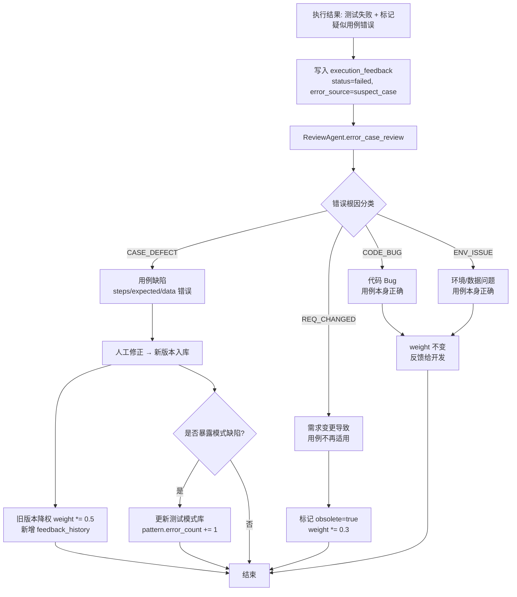

# 03 — 测试用例生成流程

> 需求输入 → 知识库匹配 → 用例生成 → 质量审核 的完整链路（含稳定性保障 + 可追溯性 + 一致性）

---

## 1. 生成流程全景

```
┌─────────────────────────────────────────────────────────────────┐
│  Phase 1: 预处理 + 影响分析                                          │
│  需求输入(已通过QualityGate) → SRR 向量化                            │
│  ↓ 新增：检测优化需求 → 检索原始需求 → 影响范围分析                  │
└──────────────────────────┬──────────────────────────────────────┘
                           │
┌──────────────────────────▼──────────────────────────────────────┐
│  Phase 1.5: 影响分析结果注入                                       │
│  ImpactAnalysisAgent:                                             │
│  - 优化需求 → 注入原始上下文 + 影响范围 + 用例更新指导              │
│  - 新需求 → 跳过                                                  │
└──────────────────────────┬──────────────────────────────────────┘
                           │
┌──────────────────────────▼──────────────────────────────────────┐
│  Phase 2: 知识检索                                               │
│  SRR Embedding → 向量检索 + 关键词匹配 + 需求模式匹配            │
│  → Top-K 匹配结果 (相似需求 + 关联用例 + 测试模式)              │
│  🔒 L2: 向量DB断路器 (故障率>20% → 降级关键词匹配)              │
└──────────────────────────┬──────────────────────────────────────┘
                           │
┌──────────────────────────▼──────────────────────────────────────┐
│  Phase 3: 多维度生成                                             │
│  GenAgent 并行生成:                                              │
│  ┌────────┐ ┌────────┐ ┌────────┐ ┌────────┐                   │
│  │ 功能    │ │ 边界值  │ │ 异常    │ │ 安全    │                   │
│  └───┬────┘ └───┬────┘ └───┬────┘ └───┬────┘                   │
│      └──────────┴──────────┴──────────┘                          │
│  用例合并 + 去重 + 追溯标注                                      │
│  🔒 L2: LLM断路器 + 重试(全抖动) + 多提供商故障转移             │
│  🔒 L3: LLM-as-Judge(5%采样) + 输出Schema校验                  │
└──────────────────────────┬──────────────────────────────────────┘
                           │
┌──────────────────────────▼──────────────────────────────────────┐
│  Phase 4: 质量审核                                               │
│  ReviewAgent: 完整性|去重|可执行|一致性|优先级|覆盖率           │
│  + 追溯性验证 (每个用例必须有需求依据)                          │
│  + 一致性检查 (多次生成方差<10%)                                 │
│  + 影响覆盖验证 (优化需求: 验证所有影响范围都有对应用例)        │
│  → 高置信度自动入库 / 低置信度人工审核                          │
└──────────────────────────┬──────────────────────────────────────┘
                           │
┌──────────────────────────▼──────────────────────────────────────┐
│  Phase 5: 格式化输出                                             │
│  FormatEngine: UTCF → Gherkin/pytest/JUnit                     │
│  + 覆盖率矩阵 + 追溯矩阵 + 影响分析报告                        │
│  🔒 L3: 输出Schema校验                                          │
└──────────────────────────┬──────────────────────────────────────┘
                           │
┌──────────────────────────▼──────────────────────────────────────┐
│  Phase 6: 回流存储                                               │
│  向量DB + PG 双写 + 需求模式库更新 + 追溯矩阵持久化             │
│  + 版本链更新 (新需求.supersedes = 旧需求ID)                    │
│  🔒 L4: 死信队列 (写入失败时)                                   │
└─────────────────────────────────────────────────────────────────┘
```

---

## 1.5 ImpactAnalysisAgent 设计（⭐ 优化需求核心）

### 问题定义

当收到**优化需求**时，现有流程只做相似度检索，无法：
1. 获取优化前的完整功能上下文
2. 分析变更的影响范围
3. 确定哪些用例需要更新/新增/删除
4. 确定回归测试范围

### ImpactAnalysisAgent 工作流程

```python
class ImpactAnalysisAgent:
    """
    影响分析 Agent：
    - 输入：SRR JSON（可能包含 optimization_context）
    - 输出：影响分析报告（指导 GenAgent 生成范围）
    """
    
    def __init__(self, pg_conn, graph_conn=None):
        self.pg = pg_conn
        self.graph = graph_conn  # Neo4j 或 networkx 图
        
    async def analyze(self, srr: dict) -> dict:
        """
        影响分析主入口
        如果是优化需求，返回详细影响分析；
        如果是新需求，返回空影响分析（跳过）
        """
        # 1. 检测是否为优化需求
        opt_context = srr.get("optimization_context")
        if not opt_context:
            return {"is_optimization": False, "impact": None}
        
        original_req = opt_context["original_requirement"]
        original_cases = opt_context["original_test_cases"]
        diff = opt_context["diff"]
        
        # 2. 分析影响范围（含跨模块分析）
        modules = srr.get("requirement", {}).get("modules", [])
        impact = await self._calculate_impact(
            original_req_id=original_req["id"],
            diff=diff,
            graph=self.graph,
            modules=modules  # 传入当前需求涉及的模块
        )
        
        # 3. 生成测试用例操作指导
        case_operations = await self._plan_case_operations(
            original_cases=original_cases,
            diff=diff,
            impact=impact
        )
        
        # 4. 生成回归测试范围
        regression_scope = await self._plan_regression_scope(
            impact=impact,
            original_cases=original_cases
        )
        
        return {
            "is_optimization": True,
            "original_requirement": original_req,
            "diff": diff,
            "impact": impact,  # 含 per_module + cross_module
            "case_operations": case_operations,  # 用例操作指导
            "regression_scope": regression_scope,  # 回归测试范围
            "cross_module_analysis": impact.get("cross_module", []),  # ✅ 新增
            "per_module_impact": impact.get("per_module", {}),  # ✅ 新增
            "generation_guidance": self._build_generation_guidance(
                case_operations, regression_scope, diff, impact
            )
        }
    
    async def _calculate_impact(self, original_req_id: str, diff: dict, graph, modules: list[str] = None) -> dict:
        """
        基于依赖图谱计算影响范围（含跨模块分析）

        成本控制策略（避免大图谱导致分析耗时失控）：
        - 节点数阈值：图谱总节点数 > MAX_GRAPH_NODES（默认 5000）→ 切换为 PG recursive CTE 限定深度
        - 遍历深度：默认 2-3 跳（MAX_TRAVERSAL_DEPTH），间接影响超过此深度不再展开
        - 超时降级：单次分析 > TIMEOUT_SECONDS（默认 5s）→ 截断当前结果 + 标记 `truncated=True`
        - 大图谱降级：返回空 indirect 列表 + warning，由 ReviewAgent 触发人工补充
        """
        MAX_GRAPH_NODES = 5000          # 与 doc-00 §9.1 MVP 对照表"< 5000 节点"一致
        MAX_TRAVERSAL_DEPTH = 3
        TIMEOUT_SECONDS = 5.0

        impact = {
            "direct": {"requirements": [], "test_cases": []},   # 直接影响（1跳）
            "indirect": {"requirements": [], "test_cases": []}, # 间接受影响（2-3跳）
            "regression": [],  # 回归测试范围
            "per_module": {},  # ✅ 新增：按模块分组的 impact
            "cross_module": [],  # ✅ 新增：跨模块依赖链
            "cost_control": {   # ✅ 新增：成本控制元信息
                "max_graph_nodes": MAX_GRAPH_NODES,
                "max_depth": MAX_TRAVERSAL_DEPTH,
                "timeout_seconds": TIMEOUT_SECONDS,
                "truncated": False,
                "degraded": False,
                "strategy": "graph",  # graph | pg_recursive | degraded
            },
        }

        # 成本控制 1：检查图谱规模
        graph_node_count = self._count_graph_nodes(graph) if graph is not None else 0
        if graph is not None and graph_node_count > MAX_GRAPH_NODES:
            # 大图谱 → 切换为 PG recursive CTE 限定深度
            impact["cost_control"]["degraded"] = True
            impact["cost_control"]["strategy"] = "pg_recursive"
            graph = None  # 强制走 PG 分支
            impact["cost_control"]["warning"] = (
                f"图谱节点数 {graph_node_count} > {MAX_GRAPH_NODES}，降级为 PG recursive CTE（深度≤{MAX_TRAVERSAL_DEPTH}）"
            )

        # 跨模块分析：如果涉及多个模块，分析模块间依赖
        if modules and len(modules) > 1:
            impact["cross_module"] = self._analyze_cross_module(modules, self.pg)
            # 按模块分组影响范围
            for mod in modules:
                impact["per_module"][mod] = {
                    "direct_reqs": [],
                    "indirect_reqs": [],
                    "test_cases": []
                }

        # 成本控制 2：超时降级（用 asyncio.wait_for 包装实际遍历）
        import asyncio
        try:
            await asyncio.wait_for(
                self._traverse_graph_or_pg(original_req_id, graph, impact, MAX_TRAVERSAL_DEPTH),
                timeout=TIMEOUT_SECONDS
            )
        except asyncio.TimeoutError:
            impact["cost_control"]["truncated"] = True
            impact["cost_control"]["warning"] = (
                f"影响分析超过 {TIMEOUT_SECONDS}s 超时，已截断 indirect 列表，建议人工补充跨模块回归范围"
            )

        return impact

    def _count_graph_nodes(self, graph) -> int:
        """安全获取图谱节点数（兼容 networkx / Neo4j wrapper）"""
        try:
            if isinstance(graph, nx.DiGraph):
                return graph.number_of_nodes()
            if hasattr(graph, "count_nodes"):
                return int(graph.count_nodes())
        except Exception:
            pass
        return 0

    async def _traverse_graph_or_pg(self, original_req_id: str, graph, impact: dict, max_depth: int):
        """实际执行图谱或 PG 遍历，可被 asyncio.wait_for 超时中断"""
        if graph is not None:
            # 使用图谱遍历（Neo4j 或 networkx）
            # 1. 找到所有依赖原始需求的需求（下游）
            #    图约定：边 A → B 表示「A depends_on B」
            #    nx.ancestors(G, n) = 所有依赖 n 的节点（n 的下游，即 ancestors）
            downstream = []
            if isinstance(graph, nx.DiGraph):
                downstream = list(nx.ancestors(graph, original_req_id))
            elif hasattr(graph, 'ancestors'):  # Neo4j wrapper
                downstream = list(graph.ancestors(original_req_id))
            impact["indirect"]["requirements"] = downstream

            # 2. 收集所有相关测试用例
            for req_id in [original_req_id] + downstream:
                cases = self._get_test_cases_for_requirement(req_id)
                impact["direct"]["test_cases"].extend(cases)
        else:
            # 无图谱时（或大图谱降级时），使用 PG 的 req_dependencies 表 + 深度限制
            cur = self.pg.cursor()
            cur.execute("""
                WITH RECURSIVE deps AS (
                    SELECT source_req_id, target_req_id, relation_type, 1 AS depth
                    FROM req_dependencies WHERE target_req_id = %s
                    UNION ALL
                    SELECT rd.source_req_id, rd.target_req_id, rd.relation_type, d.depth + 1
                    FROM req_dependencies rd
                    JOIN deps d ON rd.target_req_id = d.source_req_id
                    WHERE d.depth < %s  -- 深度限制，避免无限递归
                )
                SELECT DISTINCT source_req_id FROM deps
            """, (original_req_id, max_depth))
            downstream = [row['source_req_id'] for row in cur.fetchall()]
            impact["indirect"]["requirements"] = downstream

        # 跨模块依赖分析（注入到 return 之前）
        return impact
    
    def _analyze_cross_module(self, modules: list[str], pg_conn) -> list[dict]:
        """
        分析多个模块之间的依赖关系，识别跨模块影响链。
        返回：[{"from": "auth", "to": "session", "strength": "strong"}, ...]
        """
        if not pg_conn or len(modules) < 2:
            return []
        
        cur = pg_conn.cursor()
        # 查询模块间的需求依赖关系
        cur.execute("""
            SELECT DISTINCT rd.relation_type, r1.modules, r2.modules
            FROM req_dependencies rd
            JOIN requirements r1 ON r1.id = rd.source_req_id
            JOIN requirements r2 ON r2.id = rd.target_req_id
            WHERE rd.relation_type = 'depends_on'
              AND r1.status = 'active'
              AND r2.status = 'active'
        """)
        cross_deps = []
        for row in cur.fetchall():
            mods_1 = row['modules'] or []
            mods_2 = row['modules'] or []
            # 找出跨模块依赖
            for m1 in mods_1:
                for m2 in mods_2:
                    if m1 in modules and m2 in modules and m1 != m2:
                        cross_deps.append({
                            "from": m1,
                            "to": m2,
                            "strength": row['relation_type']
                        })
        return cross_deps
    
    def _get_module_impact(self, module: str, graph, pg_conn) -> dict:
        """
        获取单个模块的影响范围（依赖该模块的所有需求）
        """
        # 查找属于该模块的需求
        cur = pg_conn.cursor()
        cur.execute("SELECT id FROM requirements WHERE %s = ANY(modules) AND status = 'active'", (module,))
        req_ids = [row['id'] for row in cur.fetchall()]
        
        impact = {"direct": [], "indirect": []}
        for req_id in req_ids:
            if graph and isinstance(graph, nx.DiGraph):
                # 被哪些需求依赖（下游）
                descendants = nx.descendants(graph, req_id)
                impact["direct"].extend(descendants)
        return impact
    
    async def _plan_case_operations(self, original_cases: list, diff: dict, impact: dict) -> dict:
        """
        规划测试用例的操作：
        - update: 需要更新的用例（对应修改的功能点）
        - add: 需要新增的用例（对新增的功能点）
        - delete: 可以删除的用例（对应删除的功能点）
        - keep: 可以保留的用例（功能未变，但可能需要回归）
        """
        operations = {"update": [], "add": [], "delete": [], "keep": []}

        # 1. 新增功能点 → 需要新增用例
        # 注：diff.added/removed/modified 均为 list[str]（与 SRR.Diff 模型一致）
        for added_field in diff.get("added", []):
            operations["add"].append({
                "reason": f"新增功能点: {added_field}",
                "guidance": f"需要为 {added_field} 生成新的测试用例"
            })

        # 2. 删除功能点 → 可以删除对应用例
        for removed_field in diff.get("removed", []):
            # 找到测试该功能点的用例
            matching_cases = [
                c for c in original_cases
                if removed_field in json.dumps(c.get("case_json", {}), ensure_ascii=False)
            ]
            operations["delete"].extend([
                {"case_id": c["id"], "reason": f"功能点 {removed_field} 已删除"}
                for c in matching_cases
            ])

        # 3. 修改功能点 → 需要更新用例
        for modified_field in diff.get("modified", []):
            matching_cases = [
                c for c in original_cases
                if modified_field in json.dumps(c.get("case_json", {}), ensure_ascii=False)
            ]
            operations["update"].extend([
                {
                    "case_id": c["id"],
                    "reason": f"功能点 {modified_field} 已修改"
                }
                for c in matching_cases
            ])

        # 4. 未变更功能点 → 保留，但标记为需要回归
        modified_fields = set(diff.get("modified", []) +
                              diff.get("added", []) +
                              diff.get("removed", []))
        operations["keep"] = [
            {"case_id": c["id"], "reason": "功能未变，保留但需回归"}
            for c in original_cases
            if c["id"] not in [op.get("case_id") for op in operations["update"] + operations["delete"]]
        ]
        
        return operations
    
    def _build_generation_guidance(self, case_operations: dict, regression_scope: list, diff: dict) -> str:
        """
        构建给 GenAgent 的生成指导（注入 Prompt）
        """
        guidance = f"""
# 影响分析指导（优化需求）

## 原始需求
{json.dumps(diff.get("original_summary", ""), ensure_ascii=False)}

## 变更内容
- 新增: {diff.get("added", [])}
- 删除: {diff.get("removed", [])}
- 修改: {diff.get("modified", [])}

## 测试用例操作指导
- 需要新增的用例: {len(case_operations['add'])} 个（覆盖新增功能点）
- 需要更新的用例: {len(case_operations['update'])} 个（覆盖修改功能点，原有用例ID: {[op['case_id'] for op in case_operations['update']]}）
- 可以删除的用例: {len(case_operations['delete'])} 个（对应删除功能点）
- 需要回归的用例: {len(regression_scope)} 个（确保优化未破坏已有功能）

## 生成要求
1. 对于需要更新的用例，请基于原始用例进行修改，保留 original_case_id 字段
2. 对于新增功能点，请生成全新的测试用例
3. 对于删除的功能点，请在输出中标记 "operation": "delete" 对应的用例ID
4. 回归测试用例请单独标记 "type": "regression"
"""
        return guidance

# 在 GenAgent 的 Prompt 中注入影响分析指导
def build_genagent_prompt(srr: dict, impact_result: dict, few_shot_cases: list) -> str:
    """构建 GenAgent 的 Prompt，包含影响分析指导"""
    prompt = f"""
## 系统指令
你是一位资深测试工程师。请根据以下需求，生成完整的测试用例集。

## 当前需求
{json.dumps(srr, ensure_ascii=False, indent=2)}

## 参考历史用例 (Few-shot)
{json.dumps(few_shot_cases, ensure_ascii=False, indent=2)}
"""
    
    # 注入影响分析指导（仅优化需求）
    if impact_result.get("is_optimization"):
        prompt += f"""
{impact_result['generation_guidance']}
"""
    
    prompt += """
## 生成要求
1. 输出 UTCF JSON 格式
2. 每个用例必须包含 related_requirement 字段（追溯）
3. 优化需求：请按照影响分析指导操作已有用例

输出：
"""
    return prompt
```

### 与新需求的区别

| 维度 | 新需求 | 优化需求 |
|------|--------|---------|
| **上下文** | 只有当前需求描述 | 原始需求 + 当前需求 + diff |
| **用例生成范围** | 从头生成所有类型用例 | 更新已有 + 新增 + 删除 + 回归 |
| **知识库利用** | 相似需求检索 | 原始需求精确检索 + 相似需求检索 |
| **输出** | 全新用例集 | 用例操作指令（update/add/delete/keep）|
| **回归测试** | 不需要 | 必须，确保未破坏已有功能 |

---

## 2. GenAgent 核心设计

### 2.1 分类生成策略

| 测试类型 | 生成策略 | Prompt 指令 | 历史依赖 |
|----------|---------|------------|----------|
| **功能测试** | Step-by-step 推导 | SRR.flows → Given-When-Then | 高 |
| **边界值测试** | 等价类 + 边界分析 | SRR.data_constraints → 边界 | 中 |
| **异常测试** | 故障注入 + 防御推理 | 枚举故障点 + 预期处理 | 中 |
| **安全测试** | OWASP 检查清单 | SQL注入/XSS/越权/脱敏 | 低 |
| **性能测试** | 负载模型推断 | SRR.non_functional 转换 | 低 |
| **组合测试** | Pairwise/正交表 | 参数交互组合 | 中 |

### 2.2 Few-shot Prompt 模板

```markdown
## 系统指令
你是一位资深测试工程师。请根据以下需求，生成完整的测试用例集。

## 当前需求
{SRR_JSON}

## 参考历史用例 (摘自知识库)
{Top-K 历史用例}

## 测试模式参考
{匹配到的测试模式}

## 生成要求
1. **功能测试** (≥ N个) — 覆盖 happy_path 和 alternate_flows
2. **边界值测试** (≥ M个) — 覆盖 data_constraints 中的边界
3. **异常测试** (≥ P个) — 覆盖可预见的异常场景
4. **安全测试** (≥ Q个) — 覆盖安全关注点

## 输出格式 (JSON数组)
每个用例必须包含:
- id, title, type, priority, preconditions, steps, expected
- related_requirement (追溯到的需求字段)
- gen_metadata.gen_confidence (0-1, 生成阶段自评估，仅作 ReviewAgent 输入，不直接对外暴露)
  ⚠️ gen_confidence 必须放在 gen_metadata 对象内，不要放在用例顶层
  （UTCF 模型定义见 doc-04 §1，字段语义统一见 §5.2）

## 注意
- 不要重复历史用例的具体数据，只借鉴策略
- 每个用例必须可独立执行
- priority: P0=核心流程, P1=重要分支, P2=边界/异常, P3=探索性
```

### 2.3 去重策略

```python
def deduplicate_cases(cases: list[dict]) -> list[dict]:
    """三级去重: 精确匹配 → 语义去重 → 子集检测"""
    # 1. 精确去重: 同 title + 同 steps
    seen = set()
    unique = []
    for c in cases:
        key = (c["title"], json.dumps(c["steps"], sort_keys=True))
        if key not in seen:
            seen.add(key)
            unique.append(c)
    # 2. 语义去重: Embedding 余弦相似度 > 0.95 合并
    # 3. 子集去重: case_a.steps 是 case_b.steps 子集 → 保留 case_b
    return unique
```

---

## 3. 可追溯性矩阵

### 3.1 设计理念

借鉴 Auto-Validation 框架的 Traceability 指标：**每个生成的测试必须映射到具体需求**。

> 无法追溯的测试在需求变更时需手动审计，抵消 AI 生成的效率优势。

### 3.2 追溯链接

```python
@dataclass
class TraceabilityLink:
    test_case_id: str
    requirement_id: str
    requirement_field: str      # 关联到 SRR 的哪个字段
    traceability_type: str      # "direct" | "inferred" | "derived"
    confidence: float           # 0-1
    evidence: str

class TraceabilityMatrix:
    """用例 ↔ 需求 双向追溯矩阵"""
    
    def __init__(self):
        self.links: list[TraceabilityLink] = []
    
    def add_link(self, case_id, req_id, field, trace_type, confidence, evidence):
        self.links.append(TraceabilityLink(case_id, req_id, field,
                                           trace_type, confidence, evidence))
    
    def get_cases_for_requirement(self, req_id) -> list[str]:
        """需求变更影响分析：返回受影响的用例"""
        return [l.test_case_id for l in self.links if l.requirement_id == req_id]
    
    def get_orphan_cases(self, all_case_ids: set) -> set:
        """获取无追溯的孤立用例（应拦截）"""
        linked = {l.test_case_id for l in self.links}
        return all_case_ids - linked
    
    def coverage_report(self, all_req_ids: set, all_case_ids: set) -> dict:
        return {
            "coverage_rate": 1 - len(self.get_uncovered_requirements(all_req_ids)) / max(len(all_req_ids), 1),
            "traceability_rate": 1 - len(self.get_orphan_cases(all_case_ids)) / max(len(all_case_ids), 1),
            "orphan_cases": list(self.get_orphan_cases(all_case_ids))
        }
```

### 3.3 在 GenAgent 中集成追溯

```python
async def generate_with_traceability(gen_agent, srr, match_results):
    """生成用例并自动建立追溯链接"""
    test_cases = await gen_agent.generate(srr, match_results)
    matrix = TraceabilityMatrix()
    req_id = srr["requirement"]["id"]
    
    for case in test_cases:
        # 确定追溯类型和关联字段
        if case.get("related_requirement") == req_id:
            trace_type, confidence = "direct", 1.0
        elif case.get("source_pattern"):
            trace_type, confidence = "derived", 0.8
        else:
            trace_type, confidence = "inferred", 0.6
        
        # 关联到 SRR 字段
        field_map = {"functional": "flows.happy_path", "boundary": "boundary_conditions",
                     "exception": "flows.alternate_flows", "security": "non_functional.security"}
        field = field_map.get(case["type"], "test_points_hint")
        
        matrix.add_link(case["id"], req_id, field, trace_type, confidence, "")
    
    return test_cases, matrix
```

---

## 4. 生成一致性检查

### 4.1 设计理念

借鉴 Auto-Validation 的 Consistency 指标：**同一需求多次运行中测试集应保持稳定**。

> 不一致的生成使覆盖率测量不可靠，无法回答"是否可以发布"等基本问题。

### 4.2 一致性检查

```python
class ConsistencyChecker:
    async def check(self, gen_agent, srr, match_results, n=3) -> dict:
        """对同一需求生成 N 次，检查一致性"""
        runs = []
        for i in range(n):
            cases = await gen_agent.generate(srr, match_results)
            runs.append({
                "case_count": len(cases),
                "coverage": self._calc_coverage(cases, srr),
                "titles": [c["title"] for c in cases]
            })
        
        coverage_var = self._variance([r["coverage"] for r in runs])
        count_var = self._variance([r["case_count"] for r in runs])
        semantic_sim = await self._semantic_similarity(runs)
        
        return {
            "is_consistent": coverage_var < 0.05 and count_var < 3 and semantic_sim > 0.85,
            "coverage_variance": coverage_var,
            "case_count_variance": count_var,
            "semantic_similarity": semantic_sim
        }
    
    def _variance(self, values):
        if len(values) < 2: return 0.0
        mean = sum(values) / len(values)
        return sum((v - mean) ** 2 for v in values) / len(values)
```

---

## 5. ReviewAgent 质量门禁

### 5.1 审核维度

| 维度 | 检查内容 | 不通过处理 |
|------|---------|-----------|
| **完整性** | 覆盖所有 flows、boundary、business_rules | 触发 GenAgent 补充 |
| **去重** | 语义重复用例 | 保留置信度更高的 |
| **可执行性** | 前置条件 + 步骤 + 预期完整 | 标记 incomplete |
| **一致性** | 用例间无矛盾 | 标记冲突 |
| **追溯性** | 每个用例有需求依据 | 拦截孤立用例 |
| **覆盖率** | 相对 test_points_hint 的覆盖 | 低于阈值触发补充 |

### 5.2 置信度打分

> **字段语义统一**（避免 GenAgent 自评与 ReviewAgent 计算的 confidence 混淆）：
> - `gen_confidence`：GenAgent 生成时 LLM 自评估，写入 UTCF.gen_metadata.gen_confidence，**仅作为 ReviewAgent 输入**，不对外暴露。
> - `final_confidence`：ReviewAgent 通过多因子加权计算后的最终置信度，**写入 UTCF 顶层 confidence 字段**，
>   作为人工审核优先级排序和知识库入库权重的依据。
> - UTCF / KB / 输出格式中保留的字段统一为 `confidence`（即 `final_confidence` 的最终值），
>   详见 [doc-04 §5.1 _kb_metadata](./04-output-format.md#51-写入知识库的-utcf-增强) 与
>   [templates/testcase-output-template.json](../templates/testcase-output-template.json)。

```python
def calculate_confidence(case, match_results) -> float:
    """ReviewAgent 计算最终置信度 final_confidence（多因子加权）。

    输入 case 中的 gen_confidence 作为参考因子之一（权重 0.1），
    其余因子来自 ReviewAgent 的客观检查（match_score / completeness / consistency / pattern_bonus）。
    最终值写入 case["confidence"]，覆盖 GenAgent 的 gen_confidence。
    """
    match_score = max(m.similarity for m in match_results) if match_results else 0.0
    completeness = _calc_completeness(case)
    consistency = _check_consistency(case)
    pattern_bonus = 0.1 if case.get("source_pattern") else 0.0
    gen_self = float(case.get("gen_metadata", {}).get("gen_confidence", 0.5))

    # 多因子加权：客观检查 0.9 + GenAgent 自评 0.1（自评仅作弱参考，避免 LLM 过度自信）
    final_confidence = (
        0.4 * match_score
        + 0.3 * completeness
        + 0.2 * consistency
        + 0.1 * gen_self
        + pattern_bonus
    )
    return min(max(final_confidence, 0.0), 1.0)  # 钳制到 [0, 1]
```

### 5.3 变异测试设计（⭐ 优化项7）

> **问题**：ReviewAgent 的常规审核维度（完整性 / 去重 / 可执行性 / 一致性 / 追溯性 / 覆盖率）只能评估用例**形式上的质量**，无法评估用例**缺陷检测能力**——即"如果代码出错了，这些用例能否捕获？"
>
> **变异测试（Mutation Testing）** 通过向被测代码注入缺陷（变异算子），检查测试用例集是否能检测到，从而量化用例集的**实际有效性**。

#### 5.3.1 适用场景与阶段

| 阶段 | 是否启用 | 说明 |
|------|---------|------|
| MVP / Phase 1 | ❌ 不启用 | 变异测试需要可执行代码，MVP 阶段仅生成用例不执行 |
| Phase 2 | ⚠️ 可选采样 | 对 P0 优先级需求的用例集做 5% 采样变异评估 |
| Phase 3+ | ✅ 完整启用 | 与 CI/CD 集成，每次代码合并自动跑变异测试 |

> **前置条件**：变异测试依赖被测代码可执行（即 GenAgent 生成的用例已转换为 pytest/JUnit 并能运行），详见 [doc-04 §3 FormatEngine](./04-output-format.md#3-formatengine-输出格式转换)。

#### 5.3.2 变异算子（Mutation Operators）

针对测试用例生成的典型缺陷类型，定义以下变异算子：

| 算子类别 | 算子名 | 变异操作 | 对应用例类型 |
|---------|--------|---------|------------|
| 边界 | `OFF_BY_ONE` | `i < n` → `i <= n`，`i <= n` → `i < n` | boundary |
| 边界 | `NULL_CHECK_FLIP` | `if x is None` → `if x is not None` | boundary / exception |
| 逻辑 | `CONDITION_FLIP` | `if A and B` → `if A or B` | functional |
| 逻辑 | `COMPARISON_FLIP` | `>` → `<`，`>=` → `<=`，`==` → `!=` | functional / boundary |
| 数据 | `CONSTANT_CHANGE` | 数字常量 ±1 或替换为 0 / -1 / MAX_INT | boundary |
| 异常 | `EXCEPTION_SWALLOW` | 删除 `raise` 语句或 `try/except` 吞掉异常 | exception |
| 安全 | `AUTH_BYPASS` | 删除鉴权检查 / 跳过权限校验 | security |
| 安全 | `SQL_INJECTION_INTRO` | 拼接 SQL 代替参数化查询 | security |

#### 5.3.3 变异评分（Mutation Score）

```python
def calculate_mutation_score(test_cases: list, source_code: str, mutators: list) -> dict:
    """计算用例集的变异得分

    Mutation Score = killed_mutants / total_mutants
    - killed: 至少一个用例因变异而失败（说明用例能捕获该缺陷）
    - survived: 所有用例通过（说明用例无法检测该缺陷）
    - timeout: 变异导致死循环/超时（视为 killed）

    返回：
        {
            "mutation_score": float,        # 0.0-1.0，越高说明用例集缺陷检测能力越强
            "killed": int,
            "survived": int,
            "timeout": int,
            "total": int,
            "survived_mutants": [           # 未被捕获的变异，指导用例补充
                {"mutator": "OFF_BY_ONE", "file": "auth.py", "line": 42,
                 "original": "i < len(users)", "mutated": "i <= len(users)",
                 "suggested_case_type": "boundary"}
            ]
        }
    """
    results = run_mutation_testing(test_cases, source_code, mutators)
    killed = sum(1 for r in results if r["status"] == "killed")
    survived = sum(1 for r in results if r["status"] == "survived")
    timeout = sum(1 for r in results if r["status"] == "timeout")
    total = len(results)

    score = (killed + timeout) / total if total > 0 else 0.0
    return {
        "mutation_score": score,
        "killed": killed,
        "survived": survived,
        "timeout": timeout,
        "total": total,
        "survived_mutants": [r for r in results if r["status"] == "survived"]
    }
```

#### 5.3.4 ReviewAgent 集成

变异评分作为 ReviewAgent 的**离线质量信号**（不阻断在线生成流程），反馈到用例集和模式库：

```python
def review_with_mutation(self, test_cases: list, mutation_result: dict) -> dict:
    """结合变异评分生成审核报告"""
    score = mutation_result["mutation_score"]
    survived = mutation_result["survived_mutants"]

    # 变异评分阈值
    if score >= 0.8:
        verdict = "STRONG"        # 用例集缺陷检测能力强
    elif score >= 0.6:
        verdict = "ADEQUATE"      # 可接受，但有改进空间
    else:
        verdict = "WEAK"          # 触发 GenAgent 补充用例

    # 根据 survived mutants 生成补充用例建议
    suggestions = []
    for m in survived:
        suggestions.append({
            "case_type": m["suggested_case_type"],
            "reason": f"变异 {m['mutator']} 在 {m['file']}:{m['line']} 未被捕获",
            "hint": f"原代码: {m['original']} → 变异后: {m['mutated']}"
        })

    return {
        "mutation_score": score,
        "verdict": verdict,
        "supplement_suggestions": suggestions,
        "should_supplement": verdict == "WEAK"
    }
```

#### 5.3.5 成本控制

变异测试计算成本高（每个变异需重新运行用例集），采用以下控制策略：

| 策略 | 配置 | 说明 |
|------|------|------|
| 采样率 | P0 需求 100% / P1 需求 20% / P2+ 不跑 | 按优先级分配预算 |
| 变异体上限 | `MAX_MUTANTS_PER_FILE = 50` | 超过则随机采样 |
| 并行执行 | `parallel_workers = 4` | 变异体之间无依赖，可并行 |
| 超时降级 | 单变异体 > 30s → 标记 timeout，跳过 | 避免死循环变异阻塞流水线 |
| 增量变异 | 仅对本次代码变更涉及的文件跑变异 | 配合 git diff |

---

## 6. 稳定性保障措施

### 6.1 流程中的四层防护

```
Phase 2 知识检索:
  └─ L2: 向量DB断路器 (故障率>20% → 降级关键词匹配)
     └─ 重试: 指数退避+全抖动 (预算<10%总请求)

Phase 3 用例生成 (GenAgent):
  ├─ L2: LLM API 断路器 (错误率>20% / 成本>$10 / 轮次>20)
  ├─ L2: 指数退避+全抖动重试 (最多5次, 全抖动公式)
  ├─ L2: 多提供商故障转移 (DeepSeek → GPT-4o → Claude, 顺序)
  └─ L3: LLM-as-Judge质量评估 (5%采样, 分数<0.7告警)

Phase 4 质量审核:
  └─ L3: 输出Schema校验 (强制, 失败写入DLQ)

Phase 6 回流存储:
  └─ L4: 死信队列 (写入失败的任务)
```

### 6.2 断路器 (Circuit Breaker)

```python
class CircuitBreaker:
    """
    三状态机: CLOSED → OPEN → HALF_OPEN → CLOSED
    
    LLM 特有触发条件:
    - 错误率 > 20% over 60s
    - 单对话成本 > $10 (防 runaway agent)
    - 对话轮次 > 20 (防死循环)
    - 输出质量 < 0.7 (检测静默退化)
    """
    # 状态: CLOSED(正常) → 失败率超阈值 → OPEN(快速失败)
    #       → 冷却30s → HALF_OPEN(探测) → 成功3次 → CLOSED
    # Redis 后端, 支持分布式
```

### 6.3 指数退避 + 全抖动重试

```python
class RetryFramework:
    """
    全抖动公式: sleep = random(0, min(cap, base * 2^attempt))
    
    原则:
    - 重试预算 < 10% 总请求 (防重试风暴)
    - 只在最外层重试 (避免重试放大: 5层×3次=243倍)
    - 429 读 Retry-After 头, 4xx 不重试
    """
    config = {"max_attempts": 5, "base_delay": 1.0, "max_delay": 60.0,
              "retry_budget_ratio": 0.10}
```

### 6.4 多提供商故障转移

```python
class MultiProviderRouter:
    """
    顺序故障转移: DeepSeek → GPT-4o → Claude
    触发: 429(立即) / 5xx(重试2次后) / 超时(立即) / 质量<0.7(告警)
    连续失败3次 → 临时禁用该提供商10分钟
    
    基于 LiteLLM 统一接口, 所有提供商输出格式一致。
    """
```

### 6.5 优雅降级 (5 级)

```
Level 1: 全能力 (主模型 + 全工具 + 实时数据)
Level 2: 降配模型 (备用模型, 标记[降级])
Level 3: 语义缓存 (相似度>0.85的历史结果, 标记[缓存])
Level 4: 静态兜底 (预定义提示, 标记[排队])
Level 5: 延迟处理 (接收请求, 恢复后处理)
```

### 6.6 死信队列 (DLQ)

```python
class DeadLetterQueue:
    """重试耗尽的任务写入 DLQ，用于审计和恢复"""
    # Redis List 实现
    # 记录: task, error, max_retries, timestamp, status
    # 用途: 审计、根因分析、手动恢复、异常检测
```

### 6.7 死锁预防（⭐ 优化项8）

> **问题**：原方案仅 3 行注释，未覆盖 LangGraph DAG 编排中可能出现的死锁场景：
> 1. **资源循环等待**：Agent A 持有 PG 连接等待 Vector DB 连接，Agent B 持有 Vector DB 连接等待 PG 连接
> 2. **ClarifyAgent 重入死锁**：QualityGate 打回 ClarifyAgent，ClarifyAgent 又需要 KB 检索（占用 Vector DB），而 KB 检索的 LLM 调用又依赖 PG 中的相似需求元数据
> 3. **GenAgent 并行子任务死锁**：多类型并行生成（functional/boundary/exception/security）共享 ReviewAgent 队列，互相等待
> 4. **KB 写入与读取互锁**：GenAgent 等待 KB 写入完成才能读取下一批参考用例，KB Ingest Pipeline 等待 GenAgent 释放连接才能写入

#### 6.7.1 死锁预防策略

**策略 1：资源有序获取（Resource Ordering）**

所有 Agent 按统一顺序请求资源，避免循环等待：

```
资源申请顺序（全局统一）：
  1. PostgreSQL 连接（最外层，最先申请最后释放）
  2. Vector DB 连接
  3. LLM API 客户端
  4. Object Storage 连接（最内层）

任何 Agent 申请资源必须按此顺序，不允许逆向申请。
```

```python
# 全局资源序号
RESOURCE_ORDER = {
    "pg": 1,
    "vector_db": 2,
    "llm": 3,
    "object_storage": 4,
}

class OrderedResourceAcquirer:
    """强制按全局顺序申请资源，避免循环等待"""
    def __init__(self):
        self._held = set()

    async def acquire(self, resource: str, pool):
        # 检查是否违反顺序：已持有的资源序号不能 > 新申请的
        for held in self._held:
            if RESOURCE_ORDER[held] > RESOURCE_ORDER[resource]:
                raise DeadlockRiskError(
                    f"违反资源有序获取：已持有 {held}(#{RESOURCE_ORDER[held]})，"
                    f"不能申请 {resource}(#{RESOURCE_ORDER[resource]})"
                )
        conn = await pool.acquire()
        self._held.add(resource)
        return conn

    async def release(self, resource: str, conn, pool):
        await pool.release(conn)
        self._held.discard(resource)
```

**策略 2：幂等性守卫 + 任务去重**

```python
class IdempotencyGuard:
    """生成子 Agent 前检查同类型任务是否已在运行，避免重复任务互相等待"""

    def __init__(self, redis_client):
        self.redis = redis_client

    async def acquire_task_slot(self, task_key: str, ttl_seconds: int = 300) -> bool:
        """尝试占用任务槽，已占用则返回 False（避免重复执行）"""
        # SET NX 原子操作：仅当 key 不存在时设置
        acquired = await self.redis.set(
            f"task_lock:{task_key}", self._worker_id,
            nx=True, ex=ttl_seconds
        )
        return bool(acquired)

    async def release_task_slot(self, task_key: str):
        await self.redis.delete(f"task_lock:{task_key}")

# ClarifyAgent 重入守卫示例
async def clarify_with_guard(srr_id: str, iteration: int):
    task_key = f"clarify:{srr_id}:iter{iteration}"
    if not await guard.acquire_task_slot(task_key, ttl_seconds=120):
        # 同一需求的同一轮澄清已在运行，直接等待结果而非重新启动
        return await wait_for_result(task_key)
    try:
        return await _do_clarify(srr_id, iteration)
    finally:
        await guard.release_task_slot(task_key)
```

**策略 3：超时 + 主动放弃（Wait-Die / Wound-Wait）**

```python
async def acquire_with_timeout(pool, resource: str, timeout: float = 10.0):
    """资源申请带超时，超时后主动放弃并降级，避免无限等待"""
    try:
        return await asyncio.wait_for(pool.acquire(), timeout=timeout)
    except asyncio.TimeoutError:
        # 超时 → 触发降级策略（§6.5）
        logger.warning(f"资源 {resource} 申请超时 {timeout}s，触发降级")
        return None  # 调用方根据 None 走降级路径

# Wait-Die 策略：年轻任务等待，年老任务主动放弃
# Wound-Wait 策略：年老任务抢占，年轻任务回滚
# 这里采用简化版：所有任务超时即放弃，避免实现复杂度
```

**策略 4：分层架构 + 单点故障隔离**

```python
# 规划者-工作节点结构：单节点故障性能下降仅 5.5%（论文数据）
#
# 规划者（Orchestrator）：
#   - 不持有任何业务资源
#   - 仅负责任务分发和结果聚合
#   - 故障 → 重新选举（Redis 哨兵机制）
#
# 工作节点（Worker）：
#   - 每个 Worker 独立持有资源
#   - Worker 故障 → 资源自动释放（连接池 TTL）
#   - 不会阻塞其他 Worker

class Orchestrator:
    """规划者：不持有业务资源，仅分发任务"""
    async def dispatch(self, task: dict) -> dict:
        worker = await self._select_healthy_worker()
        return await worker.execute(task)

    async def _select_healthy_worker(self):
        """选择健康工作节点，故障节点自动隔离 10 分钟"""
        for worker in self.workers:
            if worker.is_healthy and not worker.is_isolated:
                return worker
        raise NoAvailableWorkerError("所有工作节点不可用")
```

**策略 5：ClarifyAgent 重入限制（防 QualityGate 循环打回）**

```python
class ClarifyLoopGuard:
    """防止 QualityGate ↔ ClarifyAgent 无限循环"""

    MAX_CLARIFY_ITERATIONS = 3  # 与 doc-01 §5.3 流程图一致

    async def run_with_limit(self, srr: dict, quality_gate):
        for iteration in range(1, self.MAX_CLARIFY_ITERATIONS + 1):
            clarify_result = await clarify_agent.clarify(srr, iteration=iteration)
            gate_result = quality_gate.check(srr, clarify_result)

            if gate_result["passed"]:
                return gate_result

            if iteration >= self.MAX_CLARIFY_ITERATIONS:
                # 达到最大轮次 → 强制输出，标记质量风险
                logger.warning(
                    f"ClarifyAgent 达到最大轮次 {self.MAX_CLARIFY_ITERATIONS}，"
                    f"强制输出（quality_score={gate_result.get('quality_score', 'N/A')}）"
                )
                return {**gate_result, "forced_pass": True,
                        "warning": "达到最大澄清轮次，强制输出"}

            # 未通过 → 打回 ClarifyAgent 继续下一轮
            srr = apply_clarify_answers(srr, clarify_result)

        # 不会执行到这里（for 循环内已 return）
```

#### 6.7.2 死锁检测与恢复

```python
class DeadlockDetector:
    """后台任务：每 30s 扫描一次资源占用，检测死锁"""

    async def detect_and_recover(self):
        while True:
            await asyncio.sleep(30)
            # 1. 检查是否有任务等待资源超过 60s
            stuck_tasks = await self._find_stuck_tasks(timeout=60)
            for task in stuck_tasks:
                # 2. 主动终止 stuck 任务，释放其持有的资源
                logger.error(f"检测到死锁任务 {task.id}，主动终止")
                await self._terminate_and_release(task)
                # 3. 任务进入 DLQ（§6.6），稍后重试
                await dlq.enqueue(task, reason="deadlock_recovery")
```

#### 6.7.3 死锁预防配置汇总

| 策略 | 配置项 | 默认值 | 说明 |
|------|--------|--------|------|
| 资源有序获取 | `RESOURCE_ORDER` | pg→vector_db→llm→object_storage | 全局统一顺序 |
| 任务去重 TTL | `task_lock_ttl` | 120s（ClarifyAgent）/ 300s（GenAgent） | 超时自动释放锁 |
| 资源申请超时 | `resource_acquire_timeout` | 10s | 超时触发降级 |
| Clarify 最大轮次 | `MAX_CLARIFY_ITERATIONS` | 3 | 防止 QualityGate 循环打回 |
| 死锁检测周期 | `deadlock_scan_interval` | 30s | 后台扫描 |
| 任务卡住阈值 | `stuck_task_threshold` | 60s | 超过则主动终止 |

---

## 7. 历史数据复用机制

### 7.1 三级复用

```
Level 1: 直接复用 (similarity > 0.95 + 人工确认过)
  → 复制用例模板，替换需求特定数据
  → 示例: CRUD接口 → 同样的增删改查模式

Level 2: 模式复用 (匹配到已知测试模式)
  → 以模式为骨架，根据当前需求填充
  → 示例: "状态机模式" → 映射状态 → 生成转移测试
  → 注意：测试模式库存储"怎么测"的骨架，与"该考虑什么"的需求模式库职责不同
          详见 doc-01 §6.0 职责边界说明

Level 3: 策略复用 (低相似度历史用例)
  → 提取测试策略作为 Few-shot 提示
  → 示例: "某需求80%缺陷在异常测试" → 引导异常场景更细致
```

### 7.2 持续优化回路

#### 7.2.1 基本回路

```
用例执行结果
  ├── 测试通过 → weight += 0.1 (稳定性加分)
  ├── 测试失败 → 用例正确但代码bug → weight不变
  │            → 用例错误 → weight *= 0.5, 标记error_case
  └── 人工修正 → 新版本入库, 旧版本降权
```

#### 7.2.2 error_case 完整闭环（⭐ 优化项4）

> **问题**：原方案仅 `标记error_case`，缺少：
> 1. error_case 如何被 ReviewAgent 复核（区分"用例缺陷"与"需求/代码变更导致的失效"）
> 2. 复核后的修正如何回流 KB（覆盖旧版本 vs 新增版本）
> 3. error_case 是否反向更新到测试模式库（避免同类错误再次生成）

**error_case 闭环流程**：



**ReviewAgent 新增方法**：

```python
def error_case_review(self, case: dict, execution_result: dict) -> dict:
    """对执行失败的用例进行根因分类，决定后续动作。

    输入：
        case: UTCF 用例（含 _kb_metadata.execution_stats）
        execution_result: {status, error_msg, stack_trace, failed_step, ...}
    输出：
        {
            "error_source": "CASE_DEFECT" | "REQ_CHANGED" | "CODE_BUG" | "ENV_ISSUE",
            "confidence": float,
            "action": "fix_and_version" | "obsolete" | "keep" | "retry",
            "next_version_id": str | None,  # action=fix_and_version 时返回新版本 ID
            "pattern_feedback": {            # 是否反向更新测试模式库
                "should_update": bool,
                "pattern_id": str | None,
                "reason": str
            }
        }
    """
    # 1. LLM 辅助根因分类（结合 stack_trace / 失败步骤 / 需求原文）
    prompt = self._build_error_review_prompt(case, execution_result)
    llm_result = call_llm(prompt, temperature=0.0, response_format="json")

    # 2. 决策动作
    action_map = {
        "CASE_DEFECT": "fix_and_version",  # 人工修正 → 新版本入库
        "REQ_CHANGED": "obsolete",         # 标记废弃
        "CODE_BUG":     "keep",            # 用例正确，反馈给开发
        "ENV_ISSUE":    "retry",           # 环境问题，标记重试
    }
    return {
        "error_source": llm_result["error_source"],
        "confidence": float(llm_result.get("confidence", 0.7)),
        "action": action_map[llm_result["error_source"]],
        "next_version_id": self._gen_next_version_id(case) if action_map[llm_result["error_source"]] == "fix_and_version" else None,
        "pattern_feedback": self._evaluate_pattern_feedback(case, llm_result),
    }
```

**回流到 KB 的字段（doc-04 §5.1 _kb_metadata 扩展）**：

```json
{
  "_kb_metadata": {
    "weight": 0.45,
    "error_case": {
      "is_error_case": true,
      "error_source": "CASE_DEFECT",
      "reviewed_by": "agent:ReviewAgent",
      "reviewed_at": "2024-07-20T14:30:00Z",
      "action": "fix_and_version",
      "obsoleted_by": "TC-LOGIN-001-v3",
      "pattern_feedback": {
        "should_update": true,
        "pattern_id": "auth_pattern",
        "reason": "auth_pattern 未覆盖 token 过期场景，需补充 error_handling 维度"
      }
    },
    "feedback_history": [
      {"date": "2024-06-25", "reviewer": "zhangsan", "action": "approved", "comment": ""},
      {"date": "2024-07-20", "reviewer": "agent:ReviewAgent", "action": "error_review",
       "comment": "CASE_DEFECT: expected 中遗漏了 token 过期校验，已生成 v3 修正版本"}
    ]
  }
}
```

**测试模式库反向更新（与 doc-01 §6 联动）**：

当 `pattern_feedback.should_update=true` 时，ImpactAnalysisAgent 或后台任务调用：

```python
def update_pattern_from_error(pattern_id: str, feedback: dict):
    """根据 error_case 反向更新测试模式库"""
    pattern = kb.get_pattern(pattern_id)
    pattern["error_count"] = pattern.get("error_count", 0) + 1
    if feedback["reason"]:
        pattern["error_notes"] = pattern.get("error_notes", [])
        pattern["error_notes"].append({
            "case_id": feedback["case_id"],
            "reason": feedback["reason"],
            "added_at": now_iso()
        })
    # error_count > 阈值 → 触发模式重构（人工或 LLM）
    if pattern["error_count"] >= 3:
        pattern["needs_review"] = True
    kb.upsert_pattern(pattern)
```

**与 doc-04 回流接口的契约**：

执行反馈通过 doc-04 §5.2 的 `KB Ingest Pipeline` 写入，新增反馈类型 `error_review`：

| feedback.action | 写入位置 | weight 变化 | 是否生成新版本 |
|-----------------|---------|------------|---------------|
| `fix_and_version` | 旧版本 `_kb_metadata.error_case` + 新版本 UTCF | 旧版本 ×0.5 | 是（`next_version_id`） |
| `obsolete` | 旧版本 `_kb_metadata.error_case` | ×0.3 | 否 |
| `keep` | 仅写入 `feedback_history` | 不变 | 否 |
| `retry` | 仅写入 `feedback_history` | 不变 | 否 |

---

## 8. 批量与增量生成

### 8.1 批量模式

```
N个需求 → 按模块分组 → 共享上下文 → 并行GenAgent → 全局去重 → 完整用例集
```

### 8.2 增量模式

```
新需求/变更 → 影响分析(匹配受影响历史需求) → 标记废弃用例 → 补充生成 → 变更报告
```

---

## 9. 生成质量控制

| 指标 | 定义 | MVP 目标值 | 完整通道目标值 |
|------|------|-----------|---------------|
| 接受率 | approved数 / 总生成数 | ≥ 80% | ≥ 85% |
| 人工修正率 | 被修改用例 / 总审核 | ≤ 20% | ≤ 15% |
| 覆盖率 | 覆盖 test_points_hint 比例 | ≥ 75% | ≥ 85% |
| 可追溯率 | 有需求依据的用例比例 | ≥ 90% | ≥ 95% |
| 一致性方差 | 多次生成覆盖率方差 | < 15% | < 10% |
| 单次生成耗时 | 1需求 → 完整用例集 | **< 30s** | **< 60s** |
| 复用命中率 | 使用历史模式/直接复用比例 | ≥ 20% | ≥ 30% |

> **说明**：
> - **MVP 链路**（2-4 次 LLM 调用，详见 [doc-00 §9.1](./00-architecture-overview.md#91-mvp-简化架构可行性优化)）目标 < 30s，与 doc-00 §9.1 一致。
> - **完整通道**（20-30 次 LLM 调用，含 ClarifyAgent / ImpactAnalysisAgent / 多类型并行生成 / ReviewAgent 全量审核）目标 < 60s。
> - 实际项目按 [doc-00 §9.1 配置驱动的通道选择](./00-architecture-overview.md#配置驱动的通道选择) 自动切换，简单需求走 MVP、复杂需求走完整通道。

---

## 10. 实施建议

1. **MVP 先做功能测试生成**，再逐步增加边界值、异常、安全
2. **Few-shot 质量 >> 数量**，精选 5-10 个高质量示例
3. **ReviewAgent 要保守**：不确定的标记人工审核
4. **温度设置**：功能测试 temperature=0.1，探索性 temperature=0.7
5. **成本控制**：轻量模型初筛，复杂需求用高端模型
6. **稳定性 P0 优先**：断路器 + 限速 + Schema校验 + DLQ 先上
