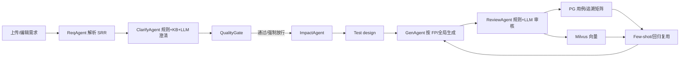
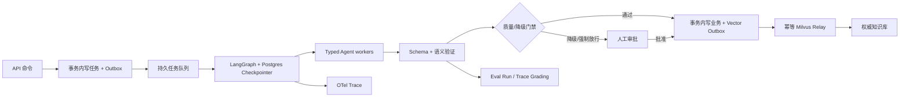

# AI 测试用例生成 Agent 端到端架构审查与优化方案

> 审查日期：2026-09-15  
> 审查范围：需求上传 → 需求解析 → 澄清 → 质量门禁 → 影响分析 → 测试设计 → 用例生成 → 审核 → PG/Milvus 沉淀 → 检索复用 → 评测与治理  
> 结论等级：**适合受控试运行，不适合“无人值守、自动入权威库”的生产模式**

---

## 1. 结论先行

### 1.1 总体判断

当前架构的主方向是对的：它本质上是一个**确定性工作流（workflow）+ 多个 LLM 能力节点**，而不是让模型自由规划一切的开放式 Agent。需求到测试用例的步骤稳定、可预定义，因此保留 LangGraph 工作流骨架符合 Anthropic“固定任务优先 workflow，只有步骤无法预先确定时才使用 agent”的建议。

系统已具备不少成熟机制：

- 清晰的 Agent 分工：Req / Clarify / Impact / Gen / Review；
- QualityGate、最大澄清轮次、人工确认、降级标记；
- L0~L3 知识权威治理、时间新鲜度、孤儿向量清理；
- A2~A5 结构完整度闭环、B1~B5 用例库治理闭环；
- SSE 进度、任务表、看门狗、评审报告、检索与权重治理；
- 当前回归基线 413/413。

但从“可长期运行、可恢复、可证明、不会污染知识库”的标准看，仍有 **5 个必须优先解决的架构断点**：

1. **降级审核和强制门禁放行后，结果仍可能自动进入 approved / Milvus**；
2. **LangGraph 没有生产级 checkpointer，现有断点续跑字段还未声明进 PipelineState**；
3. **并发互斥存在 TOCTOU，且全局 Orchestrator 共享请求级事件队列**；
4. **PG 与 Milvus 是非原子双写，TestCase 没有 outbox 和双向对账**；
5. **CI 与 Agent eval 目前不能形成真正的发布门禁**。

如果只做一轮改造，应先解决这 5 项；它们决定的是“结果能不能信、失败后能不能恢复”，优先级高于继续增加新的 Agent 能力。

---

## 2. 当前真实流程



### 2.1 控制流

| 阶段 | 入口 / 实现 | 主要产物 | 人工点 |
|---|---|---|---|
| 上传与分析 | `api/requirements.py` → `core/requirement_tasks.py` | Requirement / SRR / 功能点 | 查看分析结果 |
| 澄清 | `agents/clarify_agent.py` | questions / quality_report / structure_score | 回答问题、强制确认 |
| 生成编排 | `api/generate.py` → `core/orchestrator.py` | SSE 事件、AnalysisTask | 生成前需 confirmed |
| 门禁 | `core/quality_gate.py` | blockers / warnings / forced_pass | 当前强制放行不是正式 HITL |
| 影响与设计 | `agents/impact_agent.py` / test_design 节点 | 影响范围 / 测试蓝图 | 影响确认 |
| 生成 | `agents/gen_agent.py` | UTCF 用例、coverage IDs | 无 |
| 审核与回流 | `agents/review_agent.py` | review report / TestCase / Traceability / Milvus | reviewed 用例人工审批 |
| 检索复用 | `db/hybrid_search.py` / `core/fp_cases.py` | Few-shot / 回归基线 / KB 来源 | 来源可见 |
| 治理 | `kb_maintenance.py` / case governance / 前端报表 | 对账、权重、复用率、缺口 | 删除/归档需人工确认 |

### 2.2 当前架构定位

这不是“让一个 Agent 自主完成所有事情”的系统，而是：

> **有界工作流 + 专门 Agent + 程序化门禁 + 人工确认 + RAG 知识闭环**

这个定位是优势，不建议改成自由规划式多 Agent。流程固定时，增加自主规划只会扩大延迟、成本和级联错误面。

---

## 3. 已做得好的部分

| 能力 | 判断 | 说明 |
|---|---|---|
| 工作流分解 | **正确** | 固定阶段采用显式 DAG，符合“最简单可组合模式优先”原则 |
| 规则与 LLM 混合 | **正确** | Clarify / Review 都不是纯 LLM，自带规则层 |
| 知识权威治理 | **较成熟** | L0~L3、只信已归档/已固化、新鲜度、来源展示、孤儿 GC |
| 需求质量闭环 | **已闭环** | A2 评分 → A3 缺口澄清 → A4 Warning → A5 报表 |
| 用例库反馈闭环 | **已基本闭环** | source / weight / execution_count / 报表 / 治理扫描 |
| 真实数据标定 | **明显优点** | 阈值、字段、权重、治理条件都先实测再落地，避免空洞通过 |
| 降级可观测性 | **已有基础** | `degraded_flags` 已覆盖部分 Agent 失效 |
| 运维自愈 | **已有基础** | task watchdog、需求向量对账、孤儿报告 |

---

## 4. 关键缺陷与优化建议

## 4.1 P0：降级审核 / 门禁强制放行仍可污染权威知识库

### 证据

- `review_agent._llm_review()` 失败时返回 `review_degraded=True`；
- `orchestrator._review_node()` 在识别 `review_degraded` **之前**，已经调用 `persist_to_kb()`；
- `persist_to_kb()` 仍按置信度把用例写成 `approved` 并写 Milvus；
- `QualityGate` 在 FAST / 已确认需求上失败时会 `forced_pass=True`，后续仍进入生成、审核和回流。

关键位置：

- `backend/app/agents/review_agent.py:337-358,639-918`
- `backend/app/core/orchestrator.py:579-616,1327-1380`

### 风险

当前 N8 修复解决的是“**看得见降级**”，但没有解决“**降级产物不能自动变成权威知识**”。这会形成：

```text
LLM 审核失效 / 门禁失败
  → 规则层未发现 blocker
  → 用例 approved
  → 写入 Milvus
  → 后续 Few-shot / 回归再次消费
```

### 建议：fail-closed

- `review_degraded=True` 时：所有新用例最高只能进入 `reviewed`，禁止自动 approved；
- `forced_pass=True` 时：允许生成**预览草稿**，但禁止写 Milvus、禁止成为回归基线；
- 新增 `publication_decision = auto_approve | human_review | blocked`，由 Review 节点显式传入 `persist_to_kb()`；
- 任务终态区分：`completed` / `completed_with_warnings` / `awaiting_human_review`；
- 前端将降级审批作为真正的 approve/reject HITL，而不是仅显示 done 提示。

**验收**：注入 Review LLM 异常后，PG 中新增用例全部为 `reviewed`，Milvus 新增量为 0。

---

## 4.2 P0：断点续跑不是生产级 durable execution

### 证据

- `PipelineState` 明确写着“未声明字段会被 LangGraph 过滤”，但没有声明：
  `task_id` / `resume` / `resume_checkpoint` / `_fp_subtasks` / `_fp_groups`；
- `_gen_node()` 又从 state 读取这些字段；
- 图以 `graph.compile()` 编译，**没有 checkpointer**；
- 需求分析任务仍通过 `asyncio.create_task()` 在 API 进程内运行；进程退出后无法重放，只能被看门狗标记 interrupted；
- 自定义 checkpoint 没绑定 requirement revision、SRR hash、FP set hash、prompt/model/schema version。

关键位置：

- `backend/app/core/orchestrator.py:107-150,268-297,374`
- `backend/app/api/requirements.py:97-111`
- `backend/app/api/generate.py:52-89,211-236`

### 对照最佳实践

LangGraph 官方要求用持久化 checkpointer 保存 thread 状态，并以同一 `thread_id` 暂停/恢复；生产环境应使用 Postgres 等持久化 saver。恢复的副作用还必须幂等。

### 建议

- 将 5 个 checkpoint 字段显式加入 `PipelineState`；
- 使用 `AsyncPostgresSaver`，`thread_id = task_id`；
- checkpoint 增加输入指纹：
  `req_id/product_id/revision/srr_sha256/fp_set_sha256/prompt_version/model/schema_version`；
- resume 时任何指纹不匹配都 HTTP 409；只有显式 `fallback_to_restart=true` 才允许重头开始；
- 将需求分析与生成任务迁到持久任务队列（Celery 或 DB lease worker），API 只创建任务，不直接持有生命周期。

**验收**：在完成 2 个 FP 后杀进程，重启续跑不再调用已完成 FP，且旧 revision checkpoint 被拒绝。

---

## 4.3 P0：并发互斥与 SSE 隔离存在竞态

### 证据

- `/generate` 先在一个 session 查询活动任务，再在另一个 session 插入任务，存在 TOCTOU；
- `resume=True` 会直接绕过活动任务拒绝；
- 全局单例 `orchestrator` 持有实例字段 `_gen_event_queue`；每个请求都会覆盖它，不同需求并发时可能串事件或丢事件。

关键位置：

- `backend/app/api/generate.py:185-236`
- `backend/app/core/orchestrator.py:268-272,1640-1724`

### 建议

- 同一事务内执行 `pg_advisory_xact_lock(hashtext(req_id + ':generate'))` → 活动任务检查 → 插入；
- 再加 partial unique index 作为数据库最终防线；
- `resume` 不能绕过当前活动任务互斥；
- `_gen_event_queue` 改为 run-local，放入闭包或 `PipelineState`，禁止请求级状态挂在全局单例；
- 每个副作用携带 `run_id + idempotency_key`。

**验收**：20 个并发请求对同一 req_id 只能创建 1 个活动任务；两个不同需求的 SSE 事件不得互串。

---

## 4.4 P0：PG 与 Milvus 双写缺少事务性 outbox

### 证据

- Review 回流中 PG 记录和 Milvus 向量在不同系统写入；Milvus 写发生在 PG 最终 commit 前；
- 失败时虽有 `vector_write_failed`，但 TestCase 没有类似 Requirement 的 `vectorization_status`；
- 当前 `kb_vector_reconcile` 只对账 Requirement，未覆盖 TestCase；
- feedback 审批/驳回同样是 PG + Milvus 非原子双写。

关键位置：

- `backend/app/agents/review_agent.py:721-918`
- `backend/app/api/testcases.py`
- `backend/app/core/kb_vector_reconcile.py`
- `backend/app/db/models.py:88-128`

### 对照最佳实践

Transactional Outbox 的核心是：业务状态与 outbox 事件在**同一个本地事务**提交；独立 relay 负责至少一次投递，消费者必须幂等。

### 建议

- 新增 `vector_outbox`：`event_id/aggregate_type/aggregate_id/revision/content_hash/action/payload/status/retry_count/next_retry_at/error`；
- PG 事务内只写 TestCase + Traceability + Outbox；commit 后 dispatcher 幂等 upsert/delete Milvus；
- Milvus metadata 带 `revision/content_hash`，对账时能识别陈旧向量；
- 扩展对账到 TestCase 双向检查；
- dispatcher 使用 at-least-once，Milvus 操作按 `event_id`/主键幂等。

**验收**：分别在 PG commit 前、Milvus 成功后、relay ack 前注入崩溃，最终均可自动收敛且不重复。

---

## 4.5 P0：CI 与 Agent Eval 不是发布门禁

### 证据

- GitHub Actions 的 pytest 设置 `continue-on-error: true`；
- phase2~phase5 主要是可直接执行的脚本式测试，并非完整标准 pytest fixture；
- Prompt 候选激活仅校验客户端提交的 `confirmed_eval: bool`；未绑定服务器端 eval run；
- 检索评测集仅少量样本；`eval_retrieval.py` 名为 recall@k，实际计算“至少命中一次”的 hit rate；
- FP ID 通过简单去掉 `FP-` 前缀映射需求，实际并不等价于父 Requirement ID。

关键位置：

- `.github/workflows/test.yml:46-49`
- `backend/app/api/review_reports.py:193-196,465-498`
- `backend/scripts/eval_retrieval.py:57-79`

### 对照最佳实践

OpenAI 官方建议：调试阶段先做 trace grading；明确“好”的定义后，转为版本化 dataset + repeatable eval runs，并用评测比较 prompt、routing、guardrail 变更。

### 建议

- CI 移除 `continue-on-error`；把 413 条脚本式测试改为标准 pytest；
- 测试分层：unit（必过）/ integration（service containers）/ live（手工或夜间）；
- 新建 `evaluation_runs`，Prompt 激活必须引用一个服务器端 `passed` 的 `evaluation_run_id`；
- eval run 保存 dataset hash、prompt hash、model/provider、schema version、指标、artifact URI；
- 修正检索指标：Recall@k / MRR / nDCG@k / authority violation / stale-version rate / citation precision；
- 失败轨迹经人工 triage 后变成**可执行回归**，而不是只保存事故文本。

**验收**：任一 unit/integration/eval 门槛失败时 CI 红灯；不能用 `confirmed_eval=true` 绕过。

---

## 4.6 P1：LLM 输出只有“JSON 可解析”，没有强 Schema 与业务语义门禁

### 证据

- `_parse_json()` 对 `schema_hint` 只记录缺字段 warning，仍返回数据；不校验字段类型；
- GenAgent `allow_array=True`，没有 Pydantic response model；
- `{}`、`{"cases": null}` 等合法 JSON 可能被解析成 0 条用例；0 条分片仍可能写 checkpoint。

关键位置：

- `backend/app/core/llm_client.py:1329-1344`
- `backend/app/agents/gen_agent.py:357-374`

### 对照最佳实践

Structured Outputs / JSON Schema 能保证结构遵循，但官方同时强调：**Schema compliance 不保证内容正确**，仍需业务语义校验。

### 建议

采用两层验证：

1. **结构层**：Pydantic/JSON Schema strict，禁止多余字段；
2. **语义层**：最少用例数、ID 唯一、步骤/预期非空、引用 FP/point 存在、状态转换合法、0 条属于失败。

失败路径：结构修复一次 → 同 provider 低温重试 → 备用 provider → 明确降级/失败，不能静默成功。

---

## 4.7 P1：覆盖率回退会制造“伪 100%”

### 证据

当 `covered_point_ids` 标注率不足 30% 时，`calc_point_coverage()` 回退为：

```text
coverage = min(case_count, total_points) / total_points
P0/P1 covered = min(P0/P1 points, case_count)
uncovered = []
```

这会把“用例数量够”当成“需求要点被覆盖”。10 条重复用例也可能得到 100%。

关键位置：`backend/app/utils/coverage.py:333-371`

### 建议

- 映射证据不足时状态改为 `coverage_status="unknown"`，而不是数量比满分；
- P0/P1 自动通过必须有 `covered_point_ids + evidence`；
- 保存 `mapping_source=llm|rule|human`、`mapping_confidence`、`evidence_span`；
- 数量比只可作为“生成规模”指标，不再叫 coverage。

---

## 4.8 P1：任务状态、降级信息和乐观锁仍不完整

### 问题

- done 的 `degraded_flags` 没持久化进 `AnalysisTask.result_json`；离开 SSE 页面后丢失；
- watchdog 可把任务写 interrupted，但生成侧更新没有 `status != interrupted` 守卫，协程恢复后可能覆盖 completed；
- Requirement 编辑只有 `revision += 1`，请求无 `expected_revision`，两人并发编辑会丢失更新；
- checkpoint 没绑定 revision（见 4.2）。

### 建议

- 任务结果持久化 `completion_status/degraded_flags/failed_subtasks/review_degraded/gate_forced/kb_write_status`；
- 引入 lease/run_token，任务更新使用 CAS；
- Requirement update 必须携带 `expected_revision`，UPDATE `WHERE revision=:expected`，冲突返回 409；
- 所有确认、恢复、影响确认、澄清提交统一使用 revision 模型。

---

## 4.9 P1：知识问答错误记录与证据链不足

### 证据

- LLM 调用失败时生成“AI 服务不可用”的文本，但仍保存普通 `KnowledgeQA`，并发送正常 done；
- 回答与来源只是两个并列字段，没有 claim-to-source 引用；
- GenAgent 的 Few-shot 来源 ID / 相似度 / 权威层级主要存在日志，未落到每条用例的结构化证据链。

关键位置：

- `backend/app/api/knowledge_qa.py:460-526`
- `backend/app/agents/gen_agent.py`

### 建议

- LLM 失败记录 `answer_status=failed`，不得进入纠错归档候选；done 明确 `status=failed`；
- 回答改为 `claims[{text, source_ids, evidence_quotes}]`，服务端校验 source ID 必须来自本次检索；
- 每条生成用例保存 `evidence_sources[]`：ID、type、similarity、authority、effective_date、content_hash；
- 无证据的规则性结论必须标 `inferred=true`，不得作为确定事实回流。

---

## 4.10 P1：可观测性需要统一成标准 Trace，而不是日志拼接

### 现状问题

- 当前 trace 接口用 `task_id OR req_id` 聚合 LLM 日志，同一需求的多次运行可能混入；
- 未见统一 request/trace/span ID 贯穿 API → Orchestrator → Agent → LLM → Milvus/PG；
- prompt/content 捕获缺少统一隐私策略。

### 对照最佳实践

OpenTelemetry GenAI 语义约定建议用顶层 `invoke_agent`、子级 `chat` / `execute_tool` span，并记录 model、input/output tokens、duration、finish reason。默认不采集 prompt/tool 内容，因为可能含敏感数据；内容采集应显式 opt-in。

### 建议

- `trace_id = task_id`，每个 DAG node、LLM call、retrieval、tool、DB/Vector side effect 一个 span；
- 记录 `model/provider/prompt_version/input_tokens/output_tokens/cost/latency/retries/degradation/eval_result`；
- prompt/response 内容默认不入 trace，仅保存 hash 或脱敏摘要；
- Trace 与 eval run 关联，支持 OpenAI 所述 trace grading。

---

## 4.11 P1：安全控制需要从“鉴权”扩展到“Agent 威胁模型”

现有产品隔离与写权限是好的基础，但未见系统性控制覆盖：

- 上传需求/KB 文档中的 prompt injection；
- 检索内容投毒与记忆污染；
- LLM 输出诱导工具/数据库副作用；
- 跨产品证据泄漏；
- 敏感 prompt/需求内容进入日志或 trace。

### 建议

- 建立 Agent action policy：只读工具自动，写 DB / 发布知识 / 删除 / 外发必须明确 gate；
- RAG 内容视为**不可信数据**，与 system instruction 隔离；对可疑指令型片段标记并过滤；
- 所有工具最小权限、参数白名单、产品域绑定、审计日志；
- 对 prompt injection / data exfiltration / knowledge poisoning 做季度红队评测；
- 模型、插件、向量模型、reranker 建第三方组件清单与版本锁定。

这与 OWASP Agentic AI 威胁模型及 NIST AI RMF 的治理、测量、持续监控和人工监督方向一致。

---

### 落地说明（v3.4：威胁模型与防护清单）

按"威胁 × 现有防护 × 缺口"盘点（代码现状核过，不是抄建议）：

| 威胁 | 现有防护 | 缺口 |
|---|---|---|
| 上传需求/KB 文档的 prompt injection | RAG 内容与 system prompt 由 `_build_qa_prompt` 分离；检索内容只作上下文不做指令 | 可疑指令型片段的检测与过滤 |
| 检索投毒 / 记忆污染 | 用例只取已固化（archived_at）、需求只取 archived；纠错必须过人工审核（pending_review → approve）；answer_status=failed 的降级文本不进纠错候选 | 投毒模式的自动检测 |
| LLM 输出诱导工具/DB 副作用 | **结构性防护**：Agent 无任意工具；所有副作用走确定性 DAG 节点 + 发布门禁（publication_policy fail-closed，blocked 不触碰 DB/向量）+ 出箱 relay；LLM 输出不能直接调用任何写操作 | — |
| 跨产品证据泄漏 | Milvus metadata 强制 `product_id`（缺省兜底也不能跨）；`search_similar_cases` 按 product_id 硬过滤 | — |
| 敏感 prompt/内容进日志与 trace | llm_call_logs 记录 prompt/response（DB 侧，有鉴权）；trace 严格 task_id | prompt/response 内容默认不采集的 opt-in 策略 |
| 审计 | operation_logs + llm_call_logs + task_context（task_id/req_id 贯穿） | trace 与 eval run 关联（见 §4.10 剩余） |

结论：**"LLM 输出诱导副作用"与"跨产品泄漏"两项已由结构性设计覆盖**；prompt injection 检测、
内容脱敏 opt-in、红队评测为后续专项（需要真实语料与评审流程，不适合夹在本轮顺手做）。

---
## 5. 目标架构



### 5.1 建议保留的原则

- **保留确定性 DAG**，不要改成自由规划式 Agent；
- Agent 只负责“需要模型判断”的局部任务，状态转换、门禁、发布、权限由代码控制；
- 任何高风险副作用必须晚于验证与 HITL；
- 所有自动化结果必须能回答：**来自哪版需求、哪版 prompt、哪个模型、用了哪些证据、是否降级、如何复现**。

---

## 6. 分阶段路线图

> ### 实施进度（截至 2026-09-15）
>
> | 项 | 状态 | 落地位置 |
> |---|---|---|
> | P0-1 降级/门禁失败时 fail-closed（不写 + 终态可见） | ✅ 已做 | `core/publication_policy.py`、`review_agent.persist_to_kb`、`orchestrator._review_node` |
> | P0-2 0 用例 / Schema 不合格 / 覆盖 unknown 不得 completed | ✅ 已做 | 合同校验只记录不中断（`utils/case_validation.py`）→ 决策判 `blocked` → `completion_status=failed` |
> | P0-3 持久化 degraded_flags 与 failed_subtasks | ✅ 已做 | done 事件 + `analysis_tasks.result_json` + `review_reports.summary`（`build_case_report` 同步 `passed` 与发布决策一致） |
> | P0-4 修复 CI：pytest 失败必须阻断 | ✅ 已做 | `.github/workflows/test.yml` 去掉 `continue-on-error`；`tests/conftest.py` 做分层（脚本式 `test_phaseN_*.py` 默认不收集）；unit 层可无服务运行 |
> | P0-5 Prompt 激活绑定服务器端 eval run | ✅ 已做 | `db/models.py:EvaluationRun` + `core/evaluation.py` + `scripts/eval_prompt_candidate.py`；`activate_candidate` 不再认客户端 `confirmed_eval` |
> | P1-4.6 LLM 输出强 Schema 与业务语义门禁 | ⚠️ 部分 | 用例可执行合同已启用（`utils/case_validation.py`，实测真实数据 0.4% 不合格）；Pydantic Structured Outputs 未做 |
> | P1-4.7 覆盖证据强制化（unknown 不冒充 100%） | ✅ 已做 | `utils/coverage.py`：`coverage_status` + `observed_coverage_rate`，废止数量比口径 |
> | §4.1 前端 HITL（降级审批可见可操作） | ⚠️ 部分 | `PublicationPanel.tsx` + Generate 页展示决策/原因/降级/失败子任务、KB 跳过态；逐条 approve/reject 走既有反馈端点，尚未做批量审批入口 |
> | P1-4.3 并发互斥与 SSE 隔离 | ✅ 已做 | `core/task_guard.py`（事务内 advisory lock + 僵尸兜底 + 原子占用）、`database.py` Step 3b partial unique index、`generate.py` 改为原子占用且 **resume 不再绕过**；SSE 隔离由 ContextVar 承载并实测（探针 11/11） |
> | P1-4.4 PG→Milvus 事务性出箱 | ✅ 已做 | `vector_outbox` 表 + `core/vector_outbox.py`（enqueue 与业务行同事务、relay 至少一次幂等投递、指数退避、FOR UPDATE SKIP LOCKED）、`reconcile_cases()` 双向对账（补缺失自动、删孤儿需显式开关）、feedback 端点同事务入箱；探针 13/13 |
> | P1-4.2 durable execution | ⚠️ 接近完成 | `PipelineState` 补声明（resume/resume_checkpoint 此前被过滤，**断点续跑从未生效**）+ `core/pipeline_fingerprint.py`（checkpoint 指纹：SRR/FP 集合/修订/prompt/模型/合同版本）+ 续跑校验 409 + `fallback_to_restart`；探针 8/8。**已补**：AsyncPostgresSaver 检查点后端（thread_id=task_id 落 PG，探针 6/6；
依赖锁定 checkpoint-postgres 2.0.16——3.x 会把 checkpoint 连升 4.x 与 langgraph 0.2.68 不兼容）。
**剩余**：①续跑语义改用 saver 的 None 输入续跑（现仍走自定义 FP 断点 + 指纹，已够用）；
②任务迁出 API 进程（持久队列/DB lease） |
> | P1-4.8 任务状态/降级/乐观锁 | ✅ 已做 | ① result_json 补 `review_degraded`/`gate_forced`/`dedup_removed`/`kb_write_status`；② 状态守卫实测已满足（`_update_gen_task` 带 `status IN ('pending','running')`，interrupted/completed 不会被覆盖）；③ 需求编辑乐观锁：`expected_revision` → `FOR UPDATE` 比对 → 409（探针 7/7）。**剩余**：确认/恢复/影响确认/澄清提交的 revision 化（需前端配合） |
> | P1-4.9 KB 证据链 | ⚠️ 部分 | `answer_status=failed`：LLM 失败降级文本不再混入正常问答资产（done 带 answer_status，`/correct` 对 failed 记录 409，模型/迁移已加）。**剩余**：claims[]+source_ids 服务端校验、用例 evidence_sources[]、inferred 标记（涉及 LLM 输出 schema 与前端，待专项） |
> | P1-4.10 可观测性 Trace | ⚠️ 部分 | trace 收紧为**严格 task_id**（不再 `task_id OR req_id` 把同需求多次运行混入）。**剩余**：OTel span 树 / 内容 opt-in 采集 / eval run 关联 |
> | P1-4.11 威胁模型 | ⚠️ 文档化 | 已补「威胁 × 防护 × 缺口」清单（见 §4.11 落地说明）：两项由结构性设计覆盖，三项留专项 |
> | P2 / P3 其余 | ❌ 未做 | — |
>
> **已知行为后果**：覆盖标注率 < 30% 时 `coverage_status=unknown` → 永不自动核准（转人工）；
> 当前 `prompts/gen_agent.py` 未要求模型输出 `covered_point_ids`，标注率大概率偏低，
> 因此"自动核准"在实践中会很罕见 —— 这是 fail-closed 的**预期语义**，
> 要提升自动核准率必须先提升结构化标注率（属 P1-4.7 的后续）。

## 阶段 P0：先阻止错误结果进入权威库

1. `review_degraded` / `forced_pass` 时 fail-closed；
2. 0 用例、Schema 不合格、覆盖 unknown 不得 completed；
3. 持久化所有 degraded flags 与 failed subtasks；
4. 修复 CI：pytest 失败必须阻断；
5. Prompt 激活改为绑定服务器端 eval run。

**完成定义**：任何降级、门禁失败或空结果都不能自动 approved/向量化。

## 阶段 P1：补 durable execution 与一致性

1. LangGraph Postgres checkpointer + 完整 PipelineState；
2. checkpoint 指纹与严格 resume；
3. advisory lock + partial unique + idempotency key；
4. 移除全局事件队列；
5. PG→Milvus transactional outbox + TestCase 对账；
6. Requirement revision CAS。

**完成定义**：杀进程、重试、并发、重复投递后，最终状态一致且副作用最多一次生效。

## 阶段 P2：建立可证明的质量闭环

1. Pydantic Structured Outputs + 业务语义验证；
2. 覆盖证据强制化，unknown 不冒充 100%；
3. claim-to-source / case-to-evidence；
4. 标准 pytest + integration + eval；
5. 检索 eval 修正并扩样；
6. 将历史失败变为可执行回归；
7. 对高价值用例加入 mutation testing，验证测试是否真能发现错误，而不只“覆盖了代码”。

## 阶段 P3：标准化可观测性与安全治理

1. OpenTelemetry GenAI traces；
2. trace grading 与成本/延迟/退化趋势；
3. Agent threat model、prompt injection/knowledge poisoning 红队；
4. 模型/prompt/schema/数据集版本清单与回滚；
5. `canonical_fp_id` 替代名称作为跨版本 FP 身份。

---

## 7. 建议验收指标

| 维度 | 指标 / 断言 |
|---|---|
| 发布安全 | `review_degraded` / `forced_pass` 场景自动 approved 数 = 0，Milvus 新增数 = 0 |
| 并发 | 同一 req_id 同时最多 1 个活动生成任务；20 并发请求仅 1 成功 |
| 恢复 | 注入进程崩溃后可从持久 checkpoint 恢复，已完成 FP 不重复调用 |
| 幂等 | 同一 outbox event 重放 3 次，PG/Milvus 最终仅 1 份有效数据 |
| 结构化输出 | `{}`、字段错型、0 用例、重复 ID 均被拦截，不得 completed |
| 覆盖率 | 无映射证据时状态为 unknown，不得显示 100% |
| 证据链 | 每条自动 approved 用例有 requirement revision、prompt/model 版本、source IDs |
| 评测 | CI unit/integration/eval 任何一层失败均红灯 |
| 检索 | Recall@k、MRR、nDCG、authority violation、stale-version rate 均有版本化基线 |
| 可观测性 | 100% 任务有完整 trace；可分解 LLM/retrieval/tool/DB/Vector 延迟 |
| 安全 | prompt injection、跨产品访问、知识投毒测试进入固定红队集 |

---

## 8. 不建议做的事

1. **不要把当前确定性流程改成自由规划式多 Agent**：步骤可预测，复杂化只会放大成本和级联错误；
2. **不要继续新增能力节点，直到 P0/P1 闭环**：当前短板不是“功能少”，是“失败时仍能完成并发布”；
3. **不要用 `confirmed_eval=true` 代替评测证据**；
4. **不要把数量比叫 coverage**；
5. **不要在当前库龄不足 1 个月时自动淘汰用例**；
6. **不要同步双写 PG + Milvus 后只靠日志告警**；
7. **不要捕获完整 prompt/需求内容到 trace，除非明确开启并脱敏**；
8. **不要只用代码覆盖率评估 AI 生成测试**：应增加 mutation testing，验证测试能否发现被注入的真实故障。

---

## 9. 最终建议

### 当前可用级别

- **适合**：内部受控使用、人工确认、问题可追溯的试运行；
- **不适合**：无人值守自动发布到权威知识库、跨团队大规模并发、把 `completed` 等同于“可信完成”。

### 最优先的一个改动

如果只能做一个：

> **把 `review_degraded` 与 `forced_pass` 改成 fail-closed：只允许 reviewed / awaiting_human_review，禁止自动 approved 和 Milvus 回流。**

它能立即切断最危险的污染链，改动范围小、收益最大、容易通过注入失败验证。

---

## 10. 参考资料（截至 2026-09-15）

1. Anthropic, *Building Effective Agents*  
   https://www.anthropic.com/engineering/building-effective-agents
2. OpenAI, *Evaluate agent workflows*  
   https://platform.openai.com/docs/guides/agent-evals
3. OpenAI, *Structured Outputs*  
   https://developers.openai.com/api/docs/guides/structured-outputs
4. LangGraph, *Persistence / Durable execution*  
   https://docs.langchain.com/oss/python/langgraph/persistence
5. LangChain, *Human-in-the-loop*  
   https://docs.langchain.com/oss/python/langchain/human-in-the-loop
6. OpenTelemetry, *GenAI Observability*  
   https://opentelemetry.io/blog/2026/genai-observability/
7. OWASP GenAI Security Project, *Agentic AI Threats and Mitigations*  
   https://genai.owasp.org/resource/agentic-ai-threats-and-mitigations/
8. NIST AI 600-1, *Generative AI Profile*  
   https://www.nist.gov/publications/artificial-intelligence-risk-management-framework-generative-artificial-intelligence
9. Transactional Outbox Pattern  
   https://microservices.io/patterns/data/transactional-outbox.html
10. Meta Engineering, *LLMs are the key to mutation testing and better compliance*  
    https://engineering.fb.com/2025/09/30/security/llms-are-the-key-to-mutation-testing-and-better-compliance/
