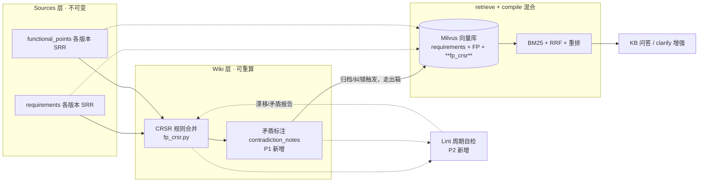

# 18 — 知识库编译化：对标 LLM Wiki 的检索优化与防腐化方案

> 生成时间：2026-09-29
> 状态：**已实施（P0 + P2，v3.5.0）**——P0 五接线点与 P2 lint 三查已落地并通过守卫单测
> + 真实端到端验证；P1（矛盾标注产品化）待 L2 扫描数据积累后启动；P3 维持低优。
> 实施偏差记录：
> ① **T5 简化**——enqueue 内嵌进 `consolidate_crsr()` 本体（fp_crsr.py），归档/纠错两条
>   调用链自动获得出箱能力，比原方案的"两处调用点各改"更优（对称性由构造保证）；
> ② **clarify 链路不接 fp_crsr**——`clarify_kb.py:126/148` 的 `doc_type="requirement"`
>   是 v2.8.53 有意设计（FP 粒度 SRR 混入致补全粒度错乱），CRSR 同为 FP 粒度，同理由排除；
>   原方案 §5.0 将 clarify 列为消费方，实施时依据既有设计决策修正；
> ③ 首轮 lint 实测：L1 漂移 1 条（PROD-53145-856/登录安全策略）、L2 矛盾 23 条、
>   L3 向量缺失 53 条（存量未 backfill，符合预期）——lint 价值首轮即实证。
> 触发：大哥方向确认——「系统每个版本归档都进向量库，且结合生成对应的最新知识库方便检索；
> 检索内容时应能检索最新整理的。这与网上说的 LLM Wiki 类似，参照该方案看我们的系统是否有优化空间」
> 方法：业界方案调研（Karpathy LLM Wiki 原始范式 + arXiv 预注册对照实验 + 批评文献）×
> 本系统代码逐点核实（file:line 引用）× DB 真实数据定标。**文档中每一条"现状"均核实过代码，
> 每一条"待办"均标注消费方，杜绝假承诺（N-4 教训）。**

---

## 1. 背景与问题

系统的知识库构建链路：项目归档 → 各版本需求/FP SRR 全量写入 Milvus → 同名功能点跨版本
聚合为 CRSR（权威完整版 SRR，`functional_point_crsr` 表）→ 供依赖图谱/影响分析直读。

**当前矛盾**：CRSR 作为「最新整理版」已经存在并在固化，但**知识库问答检索的仍然是
各历史版本的原始向量**——「检索最新整理的」这一诉求在现状下做不到。版本消解被委托给
两层运行时补丁：

1. 时间衰减（`hybrid_search.py::_apply_time_decay`，半衰期 180 天 + 0.5 基线保底）——
   旧版本仍会进入 top_k；
2. prompt 规则「多个版本同时出现时，以日期靠后的最新版本为准」
   （`knowledge_qa.py:144/225`）——把版本消解交给 LLM 临场判断，每次查询重复做一遍综合。

---

## 2. 业界调研结论

### 2.1 LLM Wiki 范式（Karpathy，2026-04）

核心思想：**编译优先（compile-first），而非检索优先（retrieve-first）**——摄取时就把
知识编译成结构化、互链的页面，查询时读编译产物，而不是每次从原始分片临时检索。

| 层/操作 | 含义 |
|---|---|
| Sources 层 | 不可变原始材料（LLM 只读不改） |
| Wiki 层 | LLM 生成并持续维护的编译页面（互链、有索引） |
| Schema 层 | 组织规则（Convention-as-Code） |
| Ingest | 摄取即编译：更新相关页面、交叉引用、标注矛盾 |
| Query | 读编译版作答 + 引用溯源 |
| Lint | 定期自检：矛盾、陈旧、孤儿、断链 |
| Preserve | 有价值的结论回流进 wiki |

### 2.2 关键证据（决定本方案取舍的三条）

| # | 证据 | 来源 | 对本方案的直接影响 |
|---|---|---|---|
| E1 | wiki 跨文档综合与 claim 级引用显著更好；但**单事实查询 RAG 达标**；wiki 查询 token 耗费 **21×**；decomp-RAG（检索式改良）以更低成本恢复 wiki 88% 的综合优势 | arXiv 2605.18490（预注册、双盲、双裁判对照实验） | 本系统 KB 问答多为**单 FP 事实查询** → 保留向量入口、CRSR 作为可检索条目的**混合形态**，优于推倒重来的纯 wiki。同时否决"全量 LLM 语义编译"（P1 因此收窄） |
| E2 | 编译模式最大软肋：**"everyone compiles, nobody recompiles"**——无构建系统盯着源，编译快照必然腐化；溯源随跳数稀释；置信度均匀无区分 | scribelet《LLM wikis: everyone compiles, nobody recompiles》 | **Lint 从"可选增强"上调为编译层必备配套**。本系统有天然优势：归档事件 = 构建触发器（相当于 make 盯 sources），缺的是漂移检测 |
| E3 | 2026 生产共识：成熟系统终点是 **hybrid**——稳定核心知识编译 + 易变数据检索 | particula.tech / bestaiweb 等 | 本系统已是三范式混合体（见 §3.1），方向正确，优化 = 接线而非换范式 |

### 2.3 竞品方案适用边界（逐项判定）

| 方案 | 强项 | 弱项 | 判定 |
|---|---|---|---|
| GraphRAG / LazyGraphRAG | 多跳/全局问题（图遍历多跳准确率 86% vs 向量 32%） | 索引贵（需 LLM 实体抽取）、持续维护 | ❌ **过度设计**——本系统已有领域专属图（FPDependency 依赖图 + backlinks，`fp_crsr.py::_build_backlinks`），影响分析已在消费；通用实体图谱对需求文档场景是杀鸡用牛刀 |
| Agentic RAG | 多轮推理、自我纠错（验证环节 ROI 最高） | 延迟 6-15s、成本 5-8×、错误沿链路传播 | ❌ **已等价拥有**——生成链 review 节点 + publication_policy（fail-closed）就是其"验证 Agent"且是确定性的；QA 侧加 agent 循环收益低 |
| Long context 全量塞入 | 零检索 | context rot（中部信息利用率下降 ~30%）+ 成本线性 | ❌ 不适用 |
| 纯 LLM Wiki（全编译） | 综合能力、知识复利 | E1/E2 全部软肋；无 RBAC/并发控制 | ⚠️ 部分——CRSR 即其工程化实现，且已具备它没有的产品隔离、version_refs 溯源、可重算 |

---

## 3. 系统现状对标（全部核实过代码）

### 3.1 本系统已是三范式混合体

| 范式 | 系统内实现 | 消费方 | 状态 |
|---|---|---|---|
| retrieve-first | Milvus + BM25 + RRF + Cross-Encoder 重排 + 时间衰减（`db/hybrid_search.py`） | KB 问答、clarify KB 补全 | ✅ 在用 |
| compile-first | CRSR（`core/fp_crsr.py`：规则式字段级合并）+ FP 用例集（`core/fp_cases.py`） | 依赖图谱节点点击、影响分析展开、test_design RTS 回归用例 | ⚠️ fp_cases 已接消费方；**CRSR 未接检索**（`fp_crsr.py:20` 头注释「（后续）知识库问答向量条目 doc_type=fp_crsr」——该"后续"至今未做） |
| graph | FPDependency 依赖图 + backlinks（`fp_crsr.py::_build_backlinks`） | 影响分析（FP 双向 BFS） | ✅ 在用，KB QA 未用 |

### 3.2 DB 真实数据定标（2026-09-29 实测）

| 指标 | 值 | 含义 |
|---|---|---|
| 需求 / FP / CRSR / 产品 | 96 / 100 / 53 / 18 | 当前规模小 |
| 多版本 FP（archived 侧） | **仅 4 个**（最多 2 版本同场竞争） | 当下"版本污染 top_k"问题真实但轻 |
| PROD-53145-856 | 8 归档需求 / 21 归档 FP / 4 双版本 FP | **版本竞争随每次归档线性恶化** |
| CRSR version_refs 链深 | 最深 2 层，覆盖 5 产品 | 编译层已在运转，只差接检索 |
| CRSR 最新固化时间 | 2026-09-14 | 若期间有归档/纠错未触发刷新，编译层已滞后（Lint 的必要性实证） |

**定标结论**：P0 的价值不在当下 QA 体验的突变，而在两处——①**clarify 增强链路的正确性**
（检索到旧版约束会作为 KB 补全依据回填 SRR，错误版本 = 错误依据，这是正确性问题不是排序问题）；
②**趋势**（每归档一次版本竞争 +1，架构应在问题恶化前就位）。

### 3.3 两个关键缺口

**缺口 1：CRSR 编译好了，但查询侧没在用它。**
检索面（Milvus requirements 集合）里没有"最新整理版"条目；版本消解靠时间衰减 + prompt
临场规则（§1 所述）。

**缺口 2：CRSR 的"编译"是纯规则合并，矛盾静默丢失。**
`fp_crsr.py::_merge_srr` 同 id 冲突静默取最新（:14 注释自认「同名同 ID 但内容冲突 →
以最新版本为准」）——两版本业务规则矛盾时（如「1-200 字符」vs「1-500 字符」），
矛盾证据直接丢弃，无任何标注；数组字段签名去重（`_item_markers`）只防字面/规范化重复，
同一规则的不同语义表述会堆积。

**缺口 3（实施层面的暗坑，本轮核实代码时发现）**：`kqa_ask` 的类型映射行
（`knowledge_qa.py` ~L638：`r["type"] = "functional_point" if _md_type == "functional_point" else "requirement"`）
只认两种类型——**任何新类型（含 fp_crsr）都会被误标为 requirement** →
`_enrich_sources` 拿它去 `requirements` 表查存在性 → 必然查不到 → 被当孤儿 `continue`
丢弃。**这正是 N-6（FP 被 requirements 误标后 L1 层静默失效）的同款缺陷形态**。
P0 实施时若只加向量不接这行，CRSR 条目将**静默不可见**——此为方案 §5.1 接线点 T2。

---

## 4. 目标架构

原则（LLM Wiki canonical boundaries + 本系统既有纪律）：
- **CRSR 是编译产物不是权威记录**——权威永远是 Sources 层各版本 SRR；CRSR 必须可重算
  （`aggregate_crsr` 纯函数已保证）、可追溯（version_refs 链已具备）；
- **规则层产出必须确定性到达消费方**，不能只当 LLM 提示词线索（MEMORY §7 纪律）；
- **降级/fail-closed 落终态**：任何编译/投递失败不得静默（复用 degraded_flags 既有契约）。

---

## 5. 方案设计

### P0（首批）：CRSR 接入向量库——「检索最新整理的」落地

**数据流**：归档/纠错 → `consolidate_crsr()` 固化（已有钩子：`products.py:1010`、
`knowledge_qa.py:1321/1403`）→ **同事务 enqueue 出箱** → relay 投递 Milvus →
KB 问答/clarify 检索面出现 `fp_crsr` 条目。

**接线点清单（5 处，缺一即静默失效——每处对应一个守卫断言）**：

| # | 位置 | 改动 | 守卫 |
|---|---|---|---|
| T1 | `core/vector_outbox.py` | `VALID_AGGREGATES` 增加 `"fp_crsr"`；`_deliver` 增加 fp_crsr 分支（payload 携带 crsr content + metadata，调 `vector_store.add_requirement`） | 单测：enqueue→deliver 全链路，Milvus 幂等 upsert |
| T2 | `api/knowledge_qa.py` kqa_ask 类型映射行 | `fp_crsr` 显式识别（**N-6 同款坑，见 §3.3 缺口 3**） | 注入测试：fp_crsr 向量进检索面后不被误标/不被孤儿过滤 |
| T3 | `api/knowledge_qa.py` `_enrich_sources` | 新增 fp_crsr 分支：按 metadata 的 (product_id, fp_name) 查 `functional_point_crsr` 表取 title/固化时间；`AUTHORITY_BY_TYPE` 增加 `"fp_crsr": "L1"` | 单测：富化后 title/authority 正确；CRSR 行被删后向量降级为孤儿过滤 |
| T4 | `prompts/knowledge_qa.py` + `_build_qa_prompt` | 引用规则增加「`fp_crsr` 类型 = 该功能的最新整理版（跨版本聚合），与单版本记录冲突时优先采信并标注」；保留"多版本以日期靠后为准"作为无 CRSR 条目时的兜底 | 回归：prompt 规则条数断言 |
| T5 | `products.py` 归档链路 + `knowledge_qa.py` 纠错链路 | `consolidate_crsr()` 成功后**同事务** `vector_outbox.enqueue(aggregate_type="fp_crsr", aggregate_id=CRSR_ID, action="upsert", payload={...})`；FP 名下所有版本向量**不删**（Sources 语义，保留可回溯） | 端到端：归档后 Milvus 出现 fp_crsr 条目且 metadata 齐全 |

**CRSR 向量 ID 方案**：`"CRSR-" + md5(product_id + "|" + fp_name)[:16]`——确定性 ID
（同一 FP 跨多次归档 upsert 同一条，不产生堆积）；metadata 必含：
`type=fp_crsr`（`add_requirement` 会自动同步 doc_type，`milvus_store.py:412`）、
`status="archived"`（**必须**——`search_similar_requirements` 按 status=archived 硬过滤，
`milvus_store.py:1138`，漏了 = 永远检索不到）、`product_id`、`fp_name`、`title=fp_name`、
`version_count`、`latest_version_ref`、`consolidated_at`。

**嵌入文本**：CRSR content 即一个完整 SRR，直接复用 `_srr_to_text`（与 requirement/FP
同口径）。

**灰度与回退**：`KB_CRSR_ENABLED`（默认 true）控制 kqa/clarify 检索结果中 fp_crsr
条目的去留；出箱事件可 `action=delete` 整体清除；CRSR 本身可随时重算重建（既有语义）。
**不迁移存量**：`fp_crsr` 条目随下一次归档/纠错自然生成；如需立即生效，提供一次性
backfill 脚本（读 functional_point_crsr 全表 enqueue，幂等）。

**明确不做**：KB 问答**不改成"只检索 CRSR"**——需求级没有编译版（CRSR 是 FP 粒度），
全量需求检索仍需原始向量；激进切换会丢需求级召回（E1：单事实查询 RAG 达标）。

### P2（首批，与 P0 并列）：Lint 周期自检——编译层防腐化标配

**依据**：E2（无 recompile 的编译层必然腐化）+ DB 定标（CRSR 最新固化 09-14，已存在
滞后窗口）。**归档事件 = 构建触发器已天然存在（consolidate_crsr 在归档链路），
Lint 补的是"触发器漏发/失败后的漂移检测"**。

挂载点：`main.py` lifespan 周期任务（项目既有惯例，无 Celery beat），默认每 24h，
`KB_LINT_INTERVAL_HOURS` 可配。三项检查（全部**只读 + 报告**，不自动改数据）：

| 查 | 逻辑 | 输出 |
|---|---|---|
| L1 CRSR 漂移 | 对每个 (product_id, fp_name)：重算 `aggregate_crsr` 与固化行 content 逐字段比对；不一致即漂移（归档时 consolidate 失败/未触发、纠错后刷新失败等） | 漂移清单 → 运维日志 + 一次性修复动作（重新 consolidate + 出箱 upsert，**人工确认后执行**，不自动改） |
| L2 跨版本规则矛盾 | 同名 FP 各版本 business_rules 中同 id 不同内容 / data_constraints 同 field 不同 constraints（`_item_markers` 的标记键可直接复用做矛盾检测） | 矛盾清单（谁与谁冲突、各来自哪个版本/需求）→ 作为 P1 contradiction_notes 的数据源 |
| L3 向量孤儿（requirements 侧） | Milvus requirements 集合 vs PG requirements/functional_point_crsr 对账（对齐 test_cases 侧既有 `reconcile_cases` 口径，补齐 docs/16 §4.1 点名的"requirements 侧无对账"） | 孤儿向量清单 → 修复动作同 L1 人工确认 |

**守卫**：三项各配单测（构造漂移/矛盾/孤儿夹具 → 扫描器必须命中）；扫描本身 fail-open
（报告失败不阻断主服务，日志 error 可见）。

### P1（收窄后，P0 落地后启动）：确定性矛盾检测 + 矛盾标注进 CRSR

**原方案（LLM 全量语义编译）已否决**——依据 E1（21× 查询成本 + decomp-RAG 证明编译
增量有限）+ 项目纪律（规则层产出必须确定性到达）。收窄为：

1. **矛盾检测规则化**（L2 的检测逻辑产品化）：consolidate_crsr 合并时，同 id 冲突不再
   静默取最新，而是把被覆盖方写入 `content["contradiction_notes"]`：
   `[{field, older_value, newer_value, older_source_req, newer_source_req, resolved_at}]`；
2. **LLM 仅叙述**：contradiction_notes 存在时，可选（开关）让 LLM 生成一段人读的
   「版本间差异说明」附在 CRSR summary——LLM 失败保留规则产物（规则层是底座，LLM 是
   增强项，fail-closed 到规则版）；
3. **消费方**：contradiction_notes 随 CRSR content 入向量嵌入文本（`_srr_to_text` 前置
   一段「⚠️ 跨版本已知差异」）+ 依赖图谱 CRSR 视图透出（前端展示项，后续排期）。

**前置条件**：P0 落地后用真实 CRSR 数据定标矛盾频率（先跑 L2 扫描拿数据，再决定
contradiction_notes 的展示优先级——遵守"阈值/合同类改动先用真实数据定标"纪律）。

### P3（低优，暂缓）：问答回流扩展

KB 问答高价值结论回流 CRSR。**维持低优判定**：现有纠错归档（原位合并 + CRSR 联动刷新，
`knowledge_qa.py:1334-1410`）已覆盖"纠错回流"主场景；泛化回流收益小、污染风险高
（LLM Wiki 边界原则：对话是 curation 输入不是 canonical 内容）。**触发条件**：
出现"同一问题反复问、答案不在任何 SRR 里"的真实案例再立项。

---

## 6. 明确不做的事（判定记录，触发条件出现可凭此立项）

| 项 | 判定理由 | 触发条件 |
|---|---|---|
| GraphRAG 通用实体图谱 | 已有领域专属图（FPDependency）；通用图谱索引贵、需求文档场景收益不明 | 出现大量跨 FP 多跳问答需求且现有图遍历不够用 |
| Agentic RAG 问答循环 | 生成链已有等价 fail-closed 验证；QA 加循环 = 延迟/成本↑ | QA 准确率评估显示单轮检索明确不足 |
| Long context 全量塞入 | context rot + 成本 | 语料规模显著缩小且模型长文能力实测改善 |
| CRSR 全量 LLM 重编译 | E1 证据 + 纪律（规则层为底座） | contradiction_notes 频率高且规则检测覆盖不足 |
| requirements 向量全面迁出箱 | 属 docs/16 §4.1 架构改造；P0 仅**新增** fp_crsr 走出箱（不动存量 requirements 的 Celery 路径，控制影响面） | 出现 Celery 队列不可观测的实际故障 |

---

## 7. 验收标准

**P0（端到端，真实链路）**：
1. 归档一个含多版本 FP 的产品 → Milvus 出现 fp_crsr 条目（metadata 六字段齐全，
   status=archived）；
2. KB 问答问该 FP 的规则 → 回答引用来源中出现「最新整理版」条目（authority=L1），
   且与单版本记录并存时 prompt 侧可辨；
3. **反证（N-6 同款守卫）**：构造 T2 未接线的场景（直接向 Milvus 写 fp_crsr 向量绕过
   类型映射）→ 必须被识别为缺陷（回归断言防回归）；
4. 出箱失败注入测试：enqueue 后 relay 前杀掉 → vector_outbox 行为 failed 可见，
   重试后幂等 upsert；
5. 全量回归（改共享模块 knowledge_qa/vector_outbox/products → 按 §21.1 纪律补跑
   phase2-6 全量 + unit），基线无回归。

**P2**：三项扫描器各配夹具单测（构造漂移/矛盾/孤儿 → 100% 命中）；线上首轮扫描结果
落报告（当前 CRSR 滞后实况 = 方案价值的直接证据）。

**P1**（启动时再细化）：contradiction_notes 到达向量文本 + 前端消费方，注入法验证。

---

## 8. 实施排期与影响面

| 阶段 | 内容 | 涉及文件 | 预估 |
|---|---|---|---|
| P0-1 | 出箱扩展 + CRSR 入库（T1/T5） | `vector_outbox.py`、`products.py`、`knowledge_qa.py`（纠错链路） | 1 天 |
| P0-2 | 检索侧接线（T2/T3/T4） | `knowledge_qa.py`、`prompts/knowledge_qa.py` | 1 天 |
| P0-3 | 守卫单测 + 端到端验收 + 全量回归 | `tests/`（新增 test_phase2_crsr_kb 或并入既有套件） | 1 天 |
| P2 | 三项扫描器 + lifespan 挂载 + 夹具单测 | 新增 `core/kb_lint.py`、`main.py` | 1 天 |
| P1 | contradiction_notes + 展示（待 P0/P2 数据定标后细化） | `fp_crsr.py`、前端 CRSR 视图 | 待定 |

**版本号**：实施时起 v3.5.0（backend/app/VERSION + frontend/package.json 同步）。

**风险与回退**：
- 最大风险 = T2/T3 接线遗漏导致 CRSR 静默不可见（N-6 同款）→ 已在验收 3 设反证守卫；
- 回退 = `KB_CRSR_ENABLED=false` 一键退回现状；出箱 delete 清除 fp_crsr 向量；
  CRSR 表本身不动（编译层独立于检索层，互不拖累）。

---

## 9. 与既有文档的关系

- `docs/13`（用例生成链路权威）：本文档不动生成链路，仅检索面扩展；
- `docs/15`（架构审查）：§4.11 威胁模型中「检索投毒」防护不变——CRSR 条目同样受
  product_id 硬过滤 + doc_type 隔离；
- `docs/16`（审计报告）：§4.1「向量写入路径二义性」部分缓解（新增 fp_crsr 统一走
  出箱；requirements 存量迁移仍单列，见 §6 判定表）；
- `KNOWN-ISSUES.md`：无新增缺陷条目（缺口 1/2 属设计演进，非缺陷；缺口 3 是 P0 实施
  前置坑登记，防复发）。
